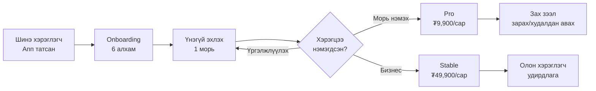

# Product — Single Source of Truth

> This is the canonical document for what Tamga is. Every feature, pricing decision, and roadmap item should trace back here.

---

## What Is Tamga?

**Tamga** (Тамга) is a platform for Mongolian horse owners to manage everything about their horses — records, health, pedigree, tournaments, marketplace, supply shop, and ownership certificates.

Mongolia has 5.1 million horses across 247,900 livestock-owning households. Horse owners currently manage their animals across notebooks, WhatsApp groups, paper vet certificates, and memory. Tamga replaces all of that with a single offline-first mobile app and marketplace.

**One-liner for different audiences:**
- **Herder:** "Your horse's passport. Free for 1 horse."
- **Breeder:** "Track health, pedigree, and breeding — in one app that actually works."
- **Race organizer:** "Register horses, track results, manage insurance — all digital."
- **Investor:** "5.1M horses, one dormant competitor, multi-stream platform. We're building the Stripe for Mongolian equine."

**Name origin:** Tamga (тамга) is the brand mark burned into a horse to mark ownership — identity, lineage, and proof in one symbol. A registry app is a digital тамга.

**One-liner:** The single source of truth for your horses.

**Name origin:** Tamga (тамга) is the brand mark burned into a horse to mark ownership — identity, lineage, and proof in one symbol. A registry app is a digital тамга.

---

## Who It's For

### Primary: Breeders & Active Owners (Уяачид, Үржүүлэгчид)

- Own 5–50+ horses
- Care deeply about pedigree, bloodline purity, inbreeding risk
- Need digital records for vet visits, vaccinations, farrier schedules
- Willing to pay ₮24,900–₮49,900/month for professional tools
- Generate valuable data (verified pedigree records) that attracts other users

### Secondary: Casual Owners (Энгийн эзэд)

- Own 1–3 horses (often family horses in rural aimags)
- Need basic health tracking, reminders, document storage
- Price-sensitive → free tier must be genuinely useful
- Upgrade trigger: second horse, or documents filling up 50MB

### Tertiary: Stables & Businesses (Жүчээ, Бизнес)

- Manage horses for multiple owners
- Need multi-user access, client portal, invoicing
- Highest ARPU (₮49,900/month)

---

## Хэрэглэгчийн аялал

---

## Core Value Props

| Value Prop | What It Means | Why It Matters |
|---|---|---|
| **Lifetime Horse Passport** | Permanent digital record tied to the horse, not the owner | Transfers with ownership; creates trust in marketplace |
| **Smart Reminders** | Auto-scheduled vet, vaccination, farrier alerts | Prevents missed health events — the #1 pain point |
| **Document Vault** | Vet certs, insurance, registration, microchip — all in one place | Pull out phone at competition or vet clinic |
| **Pedigree Engine** | 3–5 generation tree, inbreeding coefficient calculator | Breeders need this; no good Mongolian-language alternative exists |
| **Offline-First** | Full functionality without internet; sync when connected | Critical for rural Mongolia (no connectivity in pasture) |
| **Marketplace** | Buy, sell, lease horses with verified pedigree + ownership history + boost/VIP system | Replaces WhatsApp groups; verified records reduce fraud |
| **Map & Lost Horse** | Offline map with lost horse reporting, geofencing, nearby horse discovery | Critical safety feature for rural Mongolia |

---

## Feature Inventory

### Built & Working

| Feature | Status | Notes |
|---|---|---|
| Horse records (CRUD) | ✅ Built | HorseRecord model, local repository |
| Lineage tree (3/5 gen) | ✅ Built | Custom Tree/List/Timeline views, pinch-zoom canvas |
| Inbreeding calculator | ✅ Built | Coefficient calculation on pedigree |
| Health records | ✅ Built | Vaccination, deworming, treatment, vet visit logs |
| Farrier logs | ✅ Built | Shoeing, trimming, treatment records |
| Events/tournaments | ✅ Built | Race, competition, exhibition, training logs |
| Profile & settings | ✅ Built | Local settings, sync preferences |
| Search | ✅ Built | Basic horse search |
| Co-ownership | ✅ Built | Local Isar CRUD with roles/permissions, UI complete |
| Isar local storage | ✅ Built | 15 schemas, singleton DB, typed accessors |
| Sync queue + cloud sync | ✅ Built | FIFO with coalescing, bidirectional, retry, connection-aware |
| Marketplace (buy/sell/lease) | ✅ Built | Full catalog with filters, photos, trust scoring, favorites |
| Marketplace revenue | ✅ Built | VIP/Promoted boosts, seller badges, Khan Bank payment flow |
| Digital certificates | ✅ Built | Create/verify/transfer with QR codes, Supabase backend |
| Breeding tools | ✅ Built | 340-day gestation calculator, reminders, foal registration |
| Map & lost horse finder | ✅ Built | Offline map, realtime lost horse reporting, distance-aware list, geofencing, nearby horses |
| Document vault | ✅ Built | Per-horse upload (vet certs, insurance, registration, microchip) |
| Push notifications | ✅ Built | FCM infrastructure + triggers (health, geofence, breeding, market) |
| Pagination | ✅ Built | Infinite scroll on market, horses, events, health logs |

### Partially Built

| Feature | Status | Notes |
|---|---|---|
| Phone auth (OTP) | 🟡 Backend done | Supabase OTP flow works, no phone UI screen yet |
| Push notification triggers | ✅ Built | Health reminders, geofence alerts, breeding due, market inquiries |

### Not Yet Built

| Feature | Phase | Priority |
|---|---|---|
| Phone auth UI (OTP input screen) | Phase 1 | 🔴 Critical |
| Multi-provider auth | Phase 2 | 🟡 High |
| Marketplace MVP (listings + search) | Phase 1 | 🔴 Critical |
| Marketplace VIP/Boost/Premium tiers | Phase 2 | 🟡 High |
| Horse sale commission tracking | Phase 2 | 🟡 High |
| Digital certificate sales (PDF + QR) | Phase 2 | 🟡 High |
| Supply shop (feed, vitamins, equipment) | Phase 3 | 🟡 High |
| Vet marketplace (directory + booking) | Phase 3 | 🟢 Medium |
| Race organizer dashboard | Phase 3 | 🟢 Medium |
| Feature flags | Phase 3 | 🟢 Medium |
| Insurance referral integration | Phase 4 | 🟢 Medium |
| GPS collar integration | Phase 5+ | ⚪ Future |
| Expand to cattle/sheep tracking | Phase 4 | 🟡 High |

---

## Subscription Tiers

| | Free | Pro | Breeder | Stable |
|---|---|---|---|---|
| **Price** | ₮0 | ₮9,900/mo | ₮24,900/mo | ₮49,900/mo |
| **Horses** | 1 | Unlimited | Unlimited | Unlimited |
| **Storage** | 50 MB | 5 GB | 20 GB | 50 GB |
| **Pedigree** | 3 generations | 5 generations + inbreeding calc | Full + offspring prediction | Full |
| **Health** | Basic | Full + graphs | + AI alerts | Full |
| **Reminders** | — | Auto | Smart alerts | Full |
| **Breeding tools** | — | — | ✓ | ✓ |
| **Multi-user** | — | — | — | 10 users |
| **Target user** | Casual owner | Active owner | Breeder | Stable/business |

Full details: [pricing.md](./pricing.md)

---

## Pricing Psychology

Seven principles applied:
1. **Anchoring** — Stable's ₮49,900 makes Breeder look cheap
2. **Charm Pricing** — ₮9,900 < ₮10,000
3. **Good-Better-Best** — Clear 4-tier ladder
4. **Endowment Effect** — Free tier data creates switching cost
5. **Loss Aversion** — "What you lose" framing on upgrade prompts
6. **Rule of 100** — Pro annual shows %; Breeder/Stable show absolute savings
7. **Paradox of Choice** — Only 4 tiers, no decision paralysis

---

## Revenue Streams

Tamga is a **platform**, not just a subscription app. Revenue comes from transactions, services, and B2B partnerships — not just monthly fees.

| # | Stream | Type | Year 1 | Year 2 | Year 3 |
|---|---|---|---|---|---|
| 1 | Subscriptions | Recurring | ₮9.0M | ₮46.9M | ₮140.8M |
| 2 | Marketplace listings / boosts / bundles | Per-listing | ₮4.3M | ₮17.3M | ₮36.0M |
| 3 | Tamga-verified transfer fees | Per-transaction | ₮3.6M | ₮10.8M | ₮24.3M |
| 4 | Digital certificates | Per-transaction | ₮3.8M | ₮7.2M | ₮12.0M |
| 5 | On-site registration | Service | ₮19.1M | ₮23.0M | ₮26.8M |
| 6 | Race organizer SaaS (pilot) | B2B | ₮4.8M | ₮10.6M | ₮22.5M |
| 7 | Vendor pre-sales | Pre-sale | ₮4.5M | ₮3.0M | ₮4.0M |
| 8 | Other pilots | Mixed | ₮2.5M | ₮20.0M | ₮45.0M |
| | **Total gross revenue** | | **₮51.6M (~$14.7K)** | **₮138.8M (~$39.7K)** | **₮311.4M (~$89.0K)** |

Full details: [finance.md](../business/finance.md)

---

## Product Principles

1. **Source of truth for horses.** Every record a horse owner keeps should live in Tamga.
2. **Offline-first, always.** No feature should require internet to function at a basic level.
3. **Give generously on free.** The free tier should be useful, not crippled. Hook users with value, not limits.
4. **Earn the upgrade.** Every paywall should be preceded by a natural moment of need (2nd horse, full storage, breeding).
5. **Mongolian first.** Every screen, label, date format, currency display should feel native to Mongolia.
6. **Trust through verification.** Verified pedigree, ownership certificates, and review systems build platform trust.
7. **Platform, not app.** Revenue comes from transactions and services, not just subscriptions. Every marketplace listing, certificate sale, and supply order is a revenue event.

---

## User Engagement & Retention

Tamga's retention strategy relies on **real utility and financial incentives**, not gamification mechanics (like streaks or levels) which do not fit the daily reality of nomadic pastoralism.
1. **The Marketplace Wedge:** High trust scoring and verified lineage records drive higher sale prices, encouraging sellers to keep meticulous records.
2. **Safety Net Reminders:** Smart, batch-calculated health, gestation, and weather alerts help herders manage large herds (average 22 horses) easily.
3. **High Switching Cost:** Once years of veterinary logs, breeding charts, and digital certificates are registered, the data is irreplaceable, securing long-term retention.

See the full [User Engagement & Retention Strategy](./engagement.md) for more details.

---

## Success Metrics

| Metric | Phase 1 Target | Phase 3 Target |
|---|---|---|
| Registered users | 500 | 10,000 |
| Monthly active users | 200 | 5,000 |
| DAU/MAU | — | 20–25% |
| Free → Pro conversion | — | 5% |
| Pro → Breeder conversion | — | 15% |
| Marketplace listings/month | — | 200 |
| Horse sales via marketplace/month | — | 15 |
| Digital certificates sold/month | — | 165 |
| Supply shop monthly sales | — | ₮2M |
| Avg. horses per user | 2.5 | 4.0 |
| NPS | >40 | >50 |

---

## 🪝 Hook Model Mapping (Nir Eyal)

Habit-forming products move users through: Trigger → Action → Variable Reward → Investment.

| Hook Phase | Tamga Implementation | Status |
|---|---|---|
| **Trigger (External)** | Push notifications (health reminders, marketplace alerts, race results) | ✅ Built |
| **Trigger (Internal)** | "My horse might be sick" → open app; "I need to sell" → open marketplace | ⚠️ Needs habit formation |
| **Action** | Open app, view horse, add health record, browse marketplace | ✅ Built |
| **Variable Reward** | New marketplace listings, health milestone celebrations, seasonal content drops | ⚠️ Needs surprise elements |
| **Investment** | Enter horse data, add photos, build pedigree tree, complete profile | ✅ Built (one-time) |

**Gaps to fill:**
- **Variable rewards:** Add "Today's featured horse" (changes daily), random health milestones ("100 days healthy! 🎉"), seasonal breeding tips
- **Investment loop:** Breeding predictions (user enters data → AI predicts → user returns to check), horse growth tracker (chart gets more valuable with more data points)
- **Internal triggers:** Make the app the default answer to "Where did I put that vet certificate?" and "When is the next vaccination?"

---

## 🎁 Referral System

Herder-to-herder referrals are the most effective growth channel in rural communities.

| User | Action | Reward |
|---|---|---|
| **Referrer** | Shares code (e.g., `TEMUULEN22`) | 1 month Pro free per successful referral |
| **New user** | Signs up with code | Extra 50MB storage on free tier |
| **Referrer (5+ referrals)** | 5 people join | 1 month Breeder free |

**Mechanics:**
- Code = username + number (e.g., `TEMUULEN22`)
- Both parties get rewarded on successful signup
- Cap: 10 referrals per user maximum
- Track referrals in profile screen: "Таны урилга: 3 хүн нэгдсэн"

---

## Related

- [Architecture](../tech/architecture.md) — technical implementation
- [Tech Stack](../tech/tech-stack.md) — technology choices and conventions
- [Database](../tech/database.md) — schema reference
- [Design](../design/index.md) — brand and UI direction
- [Sprint Plan](../tech/sprint-plan.md) — development plan
- [Roadmap](./roadmap.md) — phased delivery plan
- [Pricing](./pricing.md) — full pricing strategy
- [Engagement](./engagement.md) — user engagement & retention strategy
- [Competitor](../market/competitor.md) — Uyach analysis
- [Marketing](../market/index.md) — GTM strategy
- [Finance](../business/finance.md) — revenue model
- [Legal](../business/legal.md) — compliance framework
