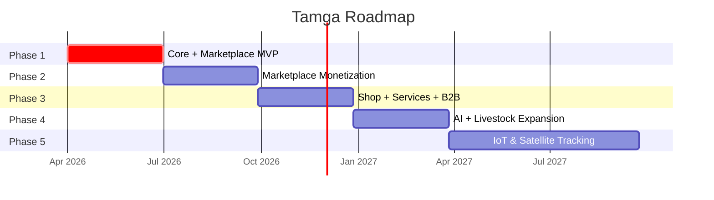
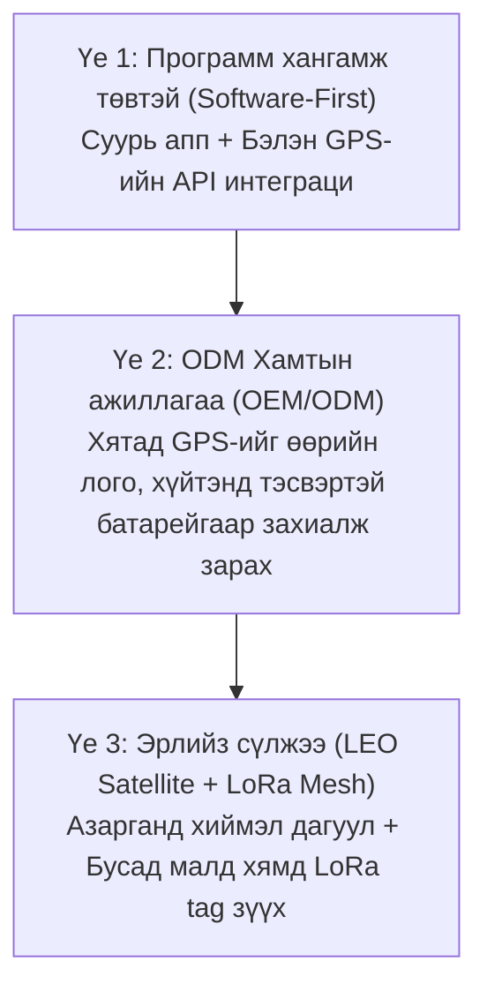

# Апп хөгжүүлэлтийн төлөвлөгөө (Roadmap)

Энэхүү баримт бичигт `Tamga` аппликейшний зорилтот хэрэглэгчид, ирээдүйд хөгжүүлэх боломжит боломжууд (features) болон үе шаттай төлөвлөгөөг тусгав.

---

## 🎯 Зорилтот хэрэглэгчийн шинжилгээ (Target User Analysis)

Аппликейшний анхны хувилбар (Lineage Prototype) нь **Удам угсаа** дээр суурилсан тул хөгжүүлэлтийн тэргүүлэх чиглэлийг дараах байдлаар тодорхойлж байна.

### 🏆 Үндсэн зорилтот хэрэглэгч: **Breeders & Active Pedigree-focused Owners** (Уяачид, Үржүүлэгчид болон Удам судар сонирхогчид)

- **Яагаад тэргүүлэх чиглэл болох вэ:**
  - Удам угсааны холбоос, цус ойртолтоос сэргийлэх, чанартай угсаа бий болгох нь үржүүлэгч нарын хамгийн том асуудал байдаг.
  - Одоогийн хөгжүүлсэн `lineage` feature (үр төл харах, 3/5 үеэр шүүх, root азарга сонгох) нь тэдний хэрэгцээнд шууд нийцнэ.
  - Breeder-үүд нь хамгийн өндөр үнэ төлөх чадвартай (Breeder Tier ~$80/mo) ба аппликейшнд үнэ цэнтэй өгөгдөл (батлагдсан удам зүй) оруулдаг гол хөдөлгүүр юм.
- **Өсөлтийн хөшүүрэг (Flywheel Effect):**
  - Breeder адуугаа зарах үедээ аппликейшнээр дамжуулан **Дижитал өмчлөлийн гэрчилгээг (Digital Ownership Certificate)** худалдан авагчид шилжүүлснээр, худалдан авагч (Casual Owner) аппликейшнд шинээр орж ирэх урсгал үүснэ.

---

## 🧠 Бүтээгдэхүүний стратегийн хүрээ (Product Strategy Framework)

*Энэ хэсэг нь хэрэглэгчид наалдах (stickiness), захиалгын стратеги болон монетизацын үндсэн зарчмуудыг тодорхойлно.*

### 🎯 Гол зарчим: Морь эзэмшигчийн "Цорын ганц үнэн эх сурвалж" болох (Single Source of Truth)

Морь эзэмшигчийн notebook, spreadsheet, WhatsApp, мал эмнэлгийн бичиг баримтад хадгалдаг бүх өгөгдлийг Tamga эзэмших ёстой. Морьтон морьдынхоо бүх амьдралыг аппликейшнд хадгалж эхэлсэн бол тэд хэзээ ч гарахгүй.

### 📋 Наалдац үүсгэх боломжууд (Sticky Features)

#### 🆔 Насан туршийн морьд паспорт (Lifetime Horse Passport)
Морьтон (owner) биш, **моринд (horse) холбогдсон** байнгын, экспортлох боломжтой дижитал бүртэл. Өмчлөл шилжих үед морины бүрэн түүх шинэ эзэнд дамжина. Худалдан авагчид үүнийг хүсдэг — энэ нь морины үнэ цэнэ, итгэлцлийг нэмэгдүүлдэг.

#### ⏰ Ухаалаг сануулга (Smart Reminders That Actually Matter)
- Вакцины хугацаа
- Туулгалтын хуваарь
- Зөвшөөрөл/бүртгэлийн сунгалт

Морьтон эдгээрийг байн мартдаг. Тэдний аюулгүйн тор болж өгөх нь итгэлцэл, наалдацыг хурдан бий болгоно.

#### 📁 Баримтын сан (Document Vault)
Мал эмнэлгийн гэрчилгээ, даатгалын баримт, бүртгэлийн бичиг, микрочипийн мэдээлэл — нэг дор, утсаар тэмцээн эсвэл эмнэлэг дээр гаргаж харуулах боломжтой.

#### 🏆 Тэмцээний аяны тэмдэглэл (Tournament Journey Tracker)
Зөвхөн үр дүн биш — бүх түүх. Цаг хугацааны зэрэглэл, шагналын мөнгө, аяллын түүх, арга хэмжээ бүрийн зураг. Морьтон энэ өгөгдөлд сэтгэл зүйн хувьд холбогддог.

### 🆓 Үнэгүй багцын стратеги: Өгөөмрөөр өгөх (Give Generously on Free)

| Юу үнэгүй вэ | Яагаад |
|---|---|
| 1 морь, бүрэн эрүүл мэндийн тэмдэглэл | Ноцтой эздийг шууд татна |
| Баримтын сан (хязгаарлагдмал багтаамж) | Баримт оруулсан бол хэрэглэгч амлалттай болсон |
| Тэмцээний үр дүн | Морины нээлттэй профайл = үнэгүй маркетинг |
| Өмчлөл шилжүүлэх бүртгэл | Платформыг итгэмжлэгдсэн бүртгэл болгоно |

Үнэгүй түвшин нь **хязгаарласан биш, харин хэрэгцээтэй** байх ёстой. Үнэ цэнийг авч буй хэрэглэгчид шинэчлэх болно — хаалттай мэт санагдсан хэрэглэгчид гарах болно.

### ⭐ Pro багц — Яагаад үнэ цэнэтэйг нь тодорхой болгох

- Хязгааргүй морьд
- Хязгааргүй баримт хадгалалт
- Эрүүл мэндийн аналитик ба график
- Ухаалаг сануулгын автоматжуулалт
- Зах зээлд тэргүүлэх байршил
- Татан авах боломжтой тайлан (даатгал, борлуулалт, малын эмчтэй хуваалцах)

### 🏘️ Stable багц

- Олон морь, олон хэрэглэгч (ажилтны бүртгэл)
- Үйлчлүүлэгчийн портал (эзэд өөрсдийн морины тэмдэглэлийг харах)
- Төлбөр тооцооны хэрэгсэл
- Олон тэмцээнд нэг дор бүртгүүлэх (Bulk entry)

### 🔑 Шүүлтийн асуулт (The Key Question)

Боломж бүрээр: *"Энэ нь эзний цаг, мөнгө, эсвэл стрессийг хэмнэх үү?"*

Тийм бол → бүтээх. Зөвхөн чамд ашигтай бол → хасах эсвэл идэвхгүй болгох (сурталчилга шиг). Хэрэглэгчид аппликейшн тэдэнд зориулж бүтээгдсэн үү, эсвэл мөнгө гаргаж авахаар бүтээгдсэн үү гэдгийг мэдэрдэг.

---

## 💰 Орлогын Тэргүүлэх Зам (Revenue-First Milestones)

Продуктийн хөгжүүлэлт нь орлогоос урагшлана. Эхний 3 сард код бичихээс илүү мөнгө олохад анхаарна.

| Сар | Зорилго | Орлогын эх үүсвэр | Хүлээгдэж буй орлого |
|---|---|---|
| **1-р сар** | Анхны мөнгө олох | Оффлайн бүртгэл + Vendor pre-sale | ₮1.5M–3M |
| **2-р сар** | Зах зээл нээх | Marketplace MVP + Featured/VIP + Boost | ₮500K–1M |
| **2-р сар** | Эрэл хайгуул monetization | Lost horse paid report + nearby broadcast + 72h boost | ₮300K–800K |
| **2-р сар** | Хэрэглэгч татах | Реферал систем + Хоршооны демо өдөрлөг | Хэрэглэгчид |
| **3-р сар** | Гэрчилгээ зарах | Certificate checkout + Seller bundles | ₮500K–1M |
| **4-р сар** | Vendor pre-sale хийх | Vendor landing page + худалдаа | ₮1M–2M |
| **4-р сар** | Итгэлцэл бий болгох | Бүтээгчийн түүх + Лендинг хуудас | Итгэлцэл |
| **5-р сар** | Тэмцээний нэгжийг турших | Race organizer pilot (2–3 event) | ₮500K–1M |
| **6-р сар** | Наадам 2026 — Брендийн үе шат | Бүртгэл, QR стикер, үнэгүй профайл | Бренд (₮3M–5M → Наадам 2027) |
| **8-р сар** | Дэлгүүр нээх | Supply shop MVP + vendor onboarding | ₮200K–500K |

**Зорилго:** 1-р сард анхны төгрөг олох. Код бичихээсээ илүү мөнгө олоход анхаарна.

---

## 🗺️ Хөгжүүлэлтийн үе шатууд (Product Phases)



---

### 📍 Phase 1: Core + Marketplace MVP (Суурь + Зах зээлийн Анхны Хувилбар)
*Зорилго: Апп-аа хэрэглээнд оруулах, зах зээлийг нээх, анхны орлого олох.*
- **Адууны профайл үүсгэх:** Зураг, видео, зүс, хүйс, төрсөн он гэх мэт суурь мэдээлэл.
- **Удмын алгоритмыг сайжруулах:** Walker's (Buchheim) алгоритм ашиглан модны дүрслэлийн давхцал болон зураасыг оновчтой болгох.
- **Арчилгааны ухаалаг хуанли ("Хяналт" цэс):** Вакцинжуулалт, туулгалт, тахлахын хуваарь болон хээлтэй гүүний төллөх хугацааг нэгтгэн харуулах хуанли.
- **Зах зээлийн анхны хувилбар (Marketplace MVP):** Үнэгүй зар + Featured түвшин (₮3,000/долоо хоног). 3 зураг, 200 тэмдэгт.
- **Эрэл хайгуулын paid report:** Хаяж морь харах/туслах нь үнэгүй, харин report нийтлэх (₮2,000), ойр хавийн notification broadcast (10 км ₮3,000, 30 км ₮5,000), 72 цаг boost (₮10,000) төлбөртэй.
- **Оффлайн бүртгэл үйлчилгээ:** Мэргэжлийн зурагчин явж, адууг бүртгүүлэх (₮29,900/адуу).
- **Цаг агаар & Зуд хяналт:** 5-10 хоногийн цаг агаарын онцгой үзэгдэл, хүйтний эрч, зудын урьдчилсан сэрэмжлүүлэг.
- **Долоо хоногийн тойм мэдэгдэл:** Хэрэглэгчийг залхаахгүй, долоо хоногт ганц удаа илгээх push мэдэгдэл.

### 📍 Phase 2: Marketplace Monetization (Зах Зээлийн Монетизаци)
*Зорилго: Зах зээлээс мөнгө олох — VIP түвшин, Boost, худалдааны шимтгэл, дижитал гэрчилгээ.*
- **VIP & Boost түвшин:** VIP (₮8,000/долоо хоног), Boost (₮2,000/өдөр), Refresh (₮1,000).
- **Худалдааны шимтгэл:** Адуу зарагдахад 3% шимтгэл (₮1M-аас доор), 2% (₮3M-аас дээш).
- **Дижитал гэрчилгээ зарах:** Өмчлөл шилжүүлэх (₮5,000), Удам судар (₮3,000), Эрүүл мэнд (₮2,500) гэрчилгээнүүд.
- **Хээлтүүлэг & Үржүүлгийн бүртгэл:** Сүрэг хуваарилалт, хээлтсэн огноо, төллөх хугацаа, унаганы бүртгэл.
- **Цус ойртолтын коэффициент:** Сонгосон гүү болон азарганы удмыг тулган цус ойртолтын эрсдэлийг тооцоолох.
- **Хамтран өмчлөх (Co-ownership):** Нэг адууны профайлыг олон эзэмшигч удирдаж, мэдээлэл оруулах эрх.
- **Facebook хуваалцах & холболт:** Удам зүй, гэрчилгээ, шинэ төл гарсан тухай визуал картуудыг FB групп рүү хуваалцах.

### 📍 Phase 3: Shop, Services & B2B (Дэлгүүр, Үйлчилгээ & B2B)
*Зорилго: Орлогын урсгалыг нэмэгдүүлэх — худалдааны дэлгүүр, малын эмчийн зах зээл, тэмцээний менежмент.*
- **Худалдааны дэлгүүр (Supply Shop):** Өвс, витамин, хэрэгсэл зарах — нийлүүлэгчдэд 5% шимтгэл.
- **Малын эмчийн зах зээл (Vet Marketplace):** Эмч нар үнэгүй жагсаалт, баталгаат эмч ₮20,000/сар.
- **Тэмцээний удирдлагын самбар (Race Organizer Dashboard):** Бүртгэл, үр дүн, мэндчилгээ — ₮500,000/арга хэмжээ.
- **Даатгалын шилжүүлэг:** Морины амьдрах даатгал, тээврийн даатгал — шилжүүлэх бүрт ₮5,000–10,000.
- **Дотоод чат систем (In-App Messaging):** Худалдагч болон худалдан авагч шууд чатаар арилжаа тохирох систем.
- **Уяач апп-аас хөрвүүлэгч (Migration tool):** Идэвхгүй болсон Уяач апп-ын хэрэглэгчдийн өгөгдлийг хуулж авах импортлогч.
- **Үнийн түүх (Price History):** Зарагдсан адуунуудын үнийн түүхийг бүс нутаг, угсаа гарлаар харах.

### 📍 Phase 4: AI, Livestock Expansion & Premium (AI, Бүх Мал & Премиум)
*Зорилго: AI болон томоохон нэмэлтүүд — бүх мал руу тэлэх, премиум шинж чанарууд.*
- **AI Үржүүлгийн зөвлөх (Claude API):** Үржүүлгийн зөвлөгөө, цус ойртолтын шинжилгээ — премиум түвшинд.
- **Бүх мал руу тэлэх:** Үхэр, хонь, ямаа нэмэх — 58M мал vs 5M морь = 6× зах зээл.
- **Уяа сойлго, сургуулилтын тэмдэглэл:** Давхил, сунгаа, хурдны тэмдэглэл, уяачийн сэтгэгдэл.
- **Наадам & Тэмцээний систем:** Наадмын бэлтгэл хуудас, тэмцээний үр дүн, адууны профайлд тэмцээний амжилтын батламж.
- **Wearable integrations:** Морины зүрхний цохилт, хөдөлгөөн хэмжигч төхөөрөмжүүдийн өгөгдөл унших.
- **Дата лицензийн бэлтгэл:** Өгөгдлийг судалгаа, даатгалын компаниудад зарахад бэлэн болгох.

### 📍 Phase 5: Advanced IoT & Satellite Tracking (Алсын хараа - Холын ирээдүй)
*Зорилго: Бэлчээрийн мал аж ахуйг сансрын болон холын зайн сүлжээгээр бүрэн автоматжуулах холбооны систем.*
- **Малын байршил тогтоогч (GPS Collar):** Сүргийн манлай малыг хиймэл дагуул болон LoRa сүлжээгээр хянах.
- **Хээрийн станц (LoRaWAN Gateway):** Өвөлжөө, зуслан дээр байршуулах бие даасан нарны зайн станц.
- **Эрлийз сүлжээний бүтэц (LEO Satellite + LoRa Mesh):** Сүргийн зардлыг хэмнэх зорилготой, азарганд хиймэл дагуул, бусад малд хямд LoRa tag зүүх шийдэл.
- **Дата лиценз:** Идэвхтэй хэрэглэгчдийн өгөгдлийг даатгалын компаниуд, судалгааны байгууллагуудад зарах.

---

## 💳 Үнийн стратеги (Pricing Strategy)

### Захиалгын багцууд
```
🆓 Free    ⭐ Pro        🌿 Breeder      🏪 Stable
₮0/сар     ₮9,900/сар    ₮24,900/сар     ₮49,900/сар
```

### Зах зээлийн үнэ
```
🆓 Зар үнэгүй    ⭐ Featured ₮3,000/долоо    🏆 VIP ₮8,000/долоо
🔥 Boost ₮2,000/өдөр    🔄 Refresh ₮1,000    📸 Нэмэлт зураг ₮500
```

### Эрэл хайгуулын үнэ
```
👀 Харах ₮0    🆘 Basic report ₮2,000
📣 10 км broadcast +₮3,000    📣 30 км broadcast +₮5,000
🚨 72 цаг urgent boost +₮10,000
```

### Бусад үйлчилгээ
```
📜 Гэрчилгээ: ₮2,500–10,000    📋 Бүртгэл: ₮29,900/адуу    🛒 Дэлгүүр: 5% шимтгэл
```

*Монгол төгрөгөөр (₮). 7 үнийн сэтгэл зүйн зарчим ашигласан: Anchoring, Charm Pricing, Good-Better-Best, Endowment Effect, Loss Aversion, Rule of 100, Paradox of Choice.*

📄 **Бүрэн хувилбар:** [Үнийн стратегийн баримт бичиг](./pricing)
— Багц тус бүрийн дэлгэрэнгүй тайлбар, сэтгэл зүйн framing, жилийн төлбөрийн хүснэгт, нэмэлт орлогын урсгал, шинэчлэх замын стратеги.

📄 **Санхүүгийн загвар:** [Finance](../business/finance)
— 12 орлогын урсгал, жилийн төсөөлөл, эргэлтийн цэг.

---

## 🔥 Давуу талууд (High-Value Differentiators)

1. **Дижитал өмчлөлийн гэрчилгээ:** Blockchain технологиор баталгаажсан адууны эзэмшил шилжүүлэх боломж нь хуурамч бичиг баримт үүсэхээс бүрэн сэргийлнэ.
2. **AI Эрүүл мэндийн дохио:** Бүртгэсэн өгөгдлүүдээс (хооллолт, дасгал хөдөлгөөн, зүрхний цохилт) гажуудал үүссэн тохиолдолд AI эзэмшигчид анхааруулга илгээнэ.
3. **Оффлайн горим:** Интернэт сүлжээ хаана ч байхгүй хөдөө хээр, жүчээн дээр апп-ыг тасралтгүй ашиглах оновчтой шийдэл.
4. **Ухаалаг wearables интеграци:** Морины биеийн тамирыг бодитоор хянах wearable integration.

---

## 🔮 Ирээдүйн тэлэлт & Малын GPS судалгаа (Future Plans & GPS Feasibility)

Малчдад зориулсан хамгийн эрэлттэй бөгөөд хэрэгцээтэй шийдэл бол **Малын байршил тогтоогч (GPS tracker)** юм. Монгол орны нөхцөлд үүнийг хэрэгжүүлэхэд дараах техникийн болон санхүүгийн сорилтууд тулгардаг.

### 📡 1. Сүлжээний технологийн сонголт (Connectivity Options)
Монголын бэлчээрийн ихэнх хэсэгт үүрэн холбооны (GSM/LTE) сүлжээ байхгүй тул стандарт SIM карттай GPS ажиллахгүй. Дараах хоёр хувилбараас сонгоно:

* **А хувилбар: Хиймэл дагуулын IoT (Direct LEO Satellite - e.g., Swarm, Astrocast)**
  * *Ажиллах зарчим:* Хүзүүвч нь GPS өгөгдлийг нам тойрог замын хиймэл дагуул руу шууд илгээнэ.
  * *Давуу тал:* Монгол орны хаана ч (тайга, говь) 100% найдвартай ажиллана. Малчинд ямар нэгэн нэмэлт суурь станц (Gateway) хэрэггүй.
  * *Сул тал:* Тоног төхөөрөмжийн өртөг өндөр, сар бүр хиймэл дагуулын дата ашигласны төлбөр төлнө.
* **Б хувилбар: LoRaWAN локал сүлжээ (Local Gateways)**
  * *Ажиллах зарчим:* Малчин өвлийн байран дээрээ нарны зайн хураагууртай LoRa станц (Gateway) босгоно. Станц нь 10-25 км радиус дахь хүзүүвчнүүдийн дохиог цуглуулж, Старлинк эсвэл үүрэн сүлжээний антеннаар дамжуулан үүлэн серверт илгээнэ.
  * *Давуу тал:* Сар бүрийн дата төлбөр байхгүй, хүзүүвч нь маш хямд бөгөөд бага эрчим хүч зарцуулдаг.
  * *Сул тал:* Мал 25 км-ээс хол бэлчвэл дохио тасарна. Станцыг малчин өөрөө арчлах шаардлагатай.

### 🔋 2. Батарей болон Цаг агаарын сорилт
Монголын өвөл -40°C хүрдэг тул стандарт Лити-ион (Lithium-ion) батарей ажиллахгүй, хөлдөж цэнэгээ алддаг. 
* **Шийдэл:** Хэт хүйтэнд ажилладаг тусгай **Li-SOCl2 (Lithium Thionyl Chloride)** батарей эсвэл бага температурт тэсвэртэй LiFePO4 батарей ашиглаж, дээр нь өндөр хамгаалалттай жижиг нарны зай (solar panel) суурилуулах шаардлагатай.

### 💰 3. Өртөг болон Үнэ (Cost & Pricing Estimation)

Малчид маш прагматик хүмүүс тул зардал нь ашиг олох хэмжээнээс бага байх ёстой.

| Бүрэлдэхүүн | Үйлдвэрлэх өртөг (Cost) | Малчинд зарах үнэ (Retail) | Сар бүрийн төлбөр (Subscription) |
| --- | --- | --- | --- |
| **LEO Satellite Хүзүүвч** | ~$60 - $80 | **$120 - $160** | **$5 - $8 / сар** |
| **LoRaWAN Хүзүүвч** | ~$15 - $25 | **$40 - $55** | Үнэгүй (эсвэл апп ашиглалт $1/сар) |
| **LoRaWAN Gateway (Станц)** | ~$110 | **$220 - $250** | Үнэгүй |

### 🐎 4. Хэрэглээний тактик: Зөвхөн "Манлай мал"-ыг хүзүүвчлэх
Малчид бэлчээрийн 300 адуундаа бүгдэд нь $150-ын хүзүүвч зүүх нь санхүүгийн хувьд боломжгүй (нийт $45,000 болно). 
* **Малчдын хэрэглэдэг арга:** Адуу бол сүрэглэх инстинкт өндөртэй тул **зөвхөн сүргийн манлай азарга (үүр татах азарга)** эсвэл тэргүүлэгч гүүнд ганц хүзүүвч зүүхэд хангалттай. 
* Ингэснээр 300 адуутай малчин ердөө **5-6 ширхэг хүзүүвч** (Нийт ~$800-$1000 орчим хөрөнгө оруулалт) авахад хангалттай бөгөөд энэ нь ганцхан адуу алдахад гарах хохирлоос хэд дахин бага тул малчдад туйлын ашигтай тусна.

### 🇨🇳 5. Хятадаас тоног төхөөрөмж нийлүүлэх (Sourcing from China)
Дэлхий дээрх бараг бүх бэлэн GPS төхөөрөмжүүдийг БНХАУ-д (голдуу Шэньжэнь хотод) үйлдвэрлэдэг тул өөрсдөө техник хангамжийг эхнээс нь угсрах бус Хятадын бэлэн үйлдвэрлэгчдээс OEM/ODM загвараар авч өөрсдийн апп-тай холбох нь хамгийн зөв гарц юм.

* **Хятадын GPS-үүдийн үнийн түвшин (Alibaba, Taobao):**
  * **Суурь 4G/Solar GPS (үүрэн сүлжээтэй):** Олноор авбал **$20 - $50** (55,000₮ - 140,000₮). Жижиглэнгээр авбал **$40 - $70**. (Жишээ нь: Хятадын алдартай RF-V26, RF-V34 нарны зайтай малын GPS-үүд).
  * **LoRaWAN Малын GPS хүзүүвч:** Олноор авбал **$30 - $60** (80,000₮ - 170,000₮). (Жишээ нь: Dragino, Netvox эсвэл HKT lora хүзүүвчнүүд).
* **Гол анхаарах сорилтууд:**
  * **Сүлжээний хязгаарлалт:** Хятадын хамгийн хямд GPS-үүд нь 2G/4G сүлжээ ашигладаг тул сүлжээгүй гүн бэлчээрт дохио дамжуулахгүй (оффлайн болно).
  * **Батарейг солих шаардлага:** Тэдний ашигладаг стандарт Лити батарейнууд Монголын өвөл хөлддөг тул Хятад үйлдвэрлэгчтэй холбогдож батарейг нь хүйтэнд тэсвэртэй (Li-SOCl2) батарейгаар солиулах эсвэл Монголд өөрсдөө угсарч солих шаардлагатай.
  * **Протоколын холболт:** Хятад үйлдвэрлэгчээс GPS-ийн TCP/UDP протоколын баримт бичгийг (SDK/API documentation) авч, манай `Tamga` аппликейшний сервер рүү өгөгдлийг нь чиглүүлж унших тохиргоо хийгдэнэ.

---

## 🏆 Технологи & Бизнесийн шилдэг гарц (Recommended 3-Step Strategy)

Уяач, малчдад зориулсан GPS болон Программ хангамжийг амжилттай зах зээлд гаргах хамгийн эрсдэл багатай бөгөөд оновчтой **3 үе шаттай шилдэг гарц (Best Path)**-ыг доорх байдлаар тодорхойлж байна.



### 🚀 Үе 1: Программ хангамж төвтэй хөгжүүлэлт (Software-First & API Integration)
* **Зорилго:** Техник хангамжийн (hardware) эрсдэл хүлээхгүйгээр апп-аа зах зээлд гаргаж турших.
* **Хэрэгжүүлэх арга зам:** 
  * Аппликейшний сервер дээр нээлттэй API Gateway үүсгэнэ.
  * Малчид өөрсдөө зах зээлээс худалдаж авсан бэлэн GPS төхөөрөмжөө (жишээ нь, Globalstar Spotter эсвэл Хятадын 4G Solar GPS) манай `Tamga` сервер рүү холбох боломжтой болгоно.
  * Манай апп зөвхөн тэдгээр өгөгдлийг уншиж, удам модтой нь холбож, ухаалаг дохиолол, оффлайн зураг дээр харуулна.
* **Яагаад шилдэг зам бэ:** Санхүүгийн асар бага эрсдэлтэй. Малчид үнэхээр уг үйлчилгээнд мөнгө төлөх эсэхийг (Product-Market Fit) хэдхэн сарын дотор батална.

### 🤝 Үе 2: Хятад үйлдвэрлэгчтэй хамтран брэнджүүлэх (OEM/ODM Partnering)
* **Зорилго:** Хүйтэнд найдвартай ажиллах хүзүүвчийг бага өртөгтэйгээр брэнд нэрээрээ зарах.
* **Хэрэгжүүлэх арга зам:**
  * Апп идэвхтэй хэрэглэгчидтэй болмогц Хятадын Шэньжэний малын GPS үйлдвэрлэгчээс OEM загвараар өөрийн `Tamga` брэндийн логотой хүзүүвчийг бага хэмжээгээр (MOQ 50-100 ширхэг) захиална.
  * Төхөөрөмжүүдийг өөрсдийн сервер рүү шууд "Plug-and-Play" ажиллахаар тохируулан Хятадаас ирүүлнэ.
  * Батарейг нь Монголын өвөлд зориулсан **Li-SOCl2**-оор сольж захиалах эсвэл Монголд өөрсдөө сольж угсрах.
* **Яагаад шилдэг зам бэ:** Бага зардлаар өөрийн брэндийн найдвартай тоног төхөөрөмжтэй болж, борлуулалтын ашгаас орлого олно.

### 🛰️ Үе 3: Хиймэл дагуул + LoRa Mesh Эрлийз хүзүүвч (LEO Satellite + LoRa Mesh Proprietary Technology)
* **Зорилго:** Сүлжээний зардлыг асар их хэмнэж, Монгол орны хаана ч 100% найдвартай ажиллах өөрсдийн технологийн давуу талыг үүсгэх.
* **Хэрэгжүүлэх арга зам:**
  * **Станц Хүзүүвч (Азарганд):** Сүргийн манлай азарганд зүүх хүзүүвчийг нам тойрог замын хиймэл дагуулын (LEO Satellite IoT - жишээ нь, Kinéis эсвэл Astrocast) модуль болон LoRa хүлээн авагчтайгаар бүтээнэ.
  * **Дагагч Tag (Бусад малд):** Бусад гүү, морьдод маш хямд, хөнгөн LoRa tag зүүнэ. Эдгээр нь GPS-гүй, зөвхөн азарганы станц хүзүүвчтэй холбогдож ажиллана.
  * **Ажиллах зарчим:** Дагагч малуудын LoRa tag нь азарганы станц хүзүүвч рүү өөрсдийн дохиогоо өгнө (үнэгүй). Азарганы хүзүүвч нь нийт сүргийн байршил, мэдээллийг багцлан хиймэл дагуул руу дамжуулна (сар бүр зөвхөн 1 хиймэл дагуулын дата төлбөр төлнө).
* **Яагаад шилдэг зам бэ:** Мал бүрт хиймэл дагуулын $10/сар төлбөр төлөх байсныг сүрэг тутамд $10/сар болгон бууруулна. Энэ нь манай компанийг технологийн болон үнийн хувьд өрсөлдөгчгүй болгоно.


