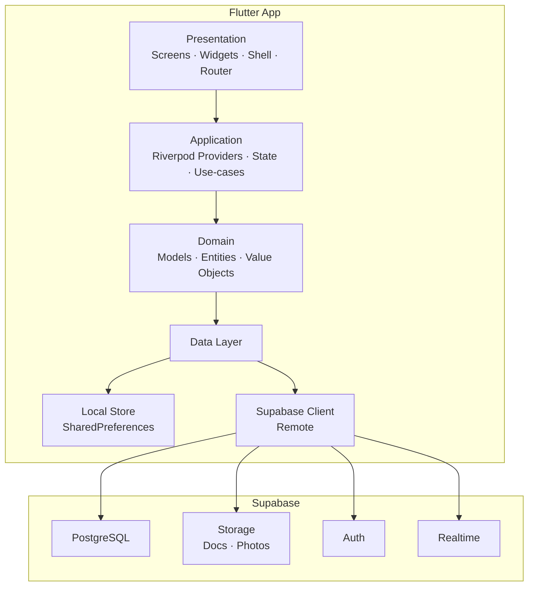
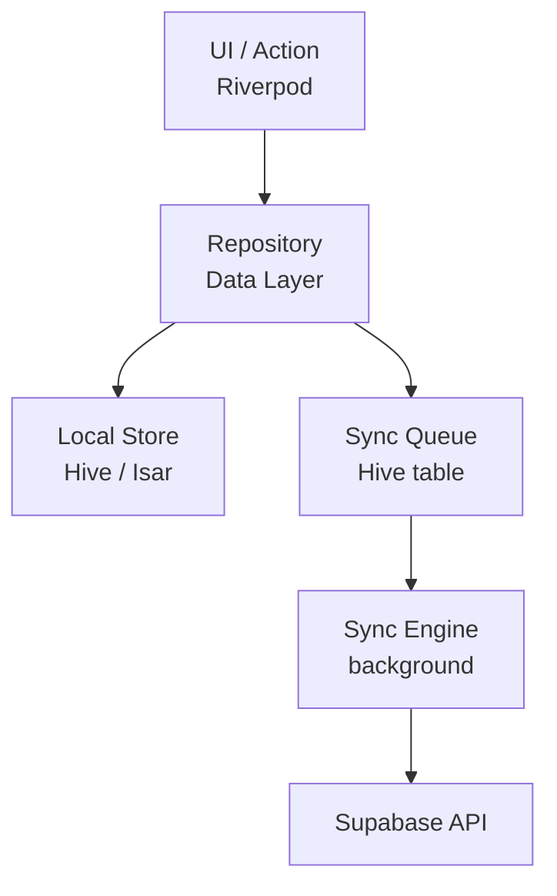
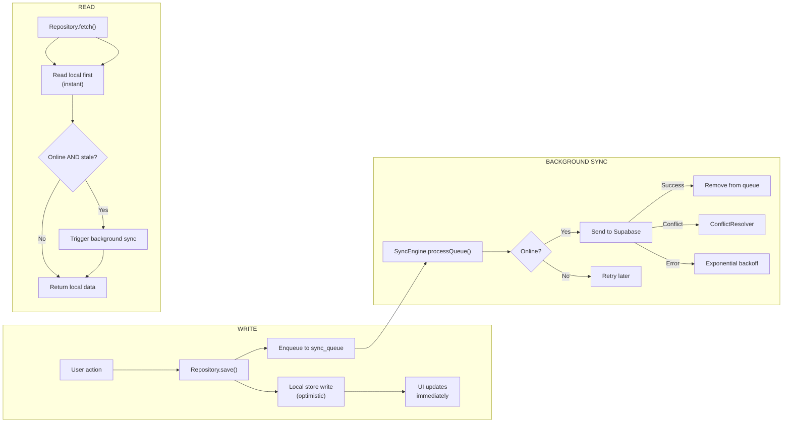

# Техникийн архитектур (Technical Architecture)

> **Зорилго:** Offline-first, Mongold ажиллах, хээрийн нөхцөлд тэсвэртэй, ирээдүйд feature нэмэхэд хялбар архитектур.

---

## 🏗️ Overall Architecture



### Layer Rules

| Layer | Зорилго | Хориг (Must Not) |
|---|---|---|
| **Domain** | Model, enum, бизнес дүрэм. Бусад layer-ээс хараат бус | Flutter, Supabase, Riverpod ашиглахгүй |
| **Data** | Local/remote хадгалалт, sync, API | UI код агуулахгүй. Provider үүсгэхгүй |
| **Application** | Riverpod provider, use-case, state management | UI import хийхгүй. Domain-оос өөр зүйл import хийхгүй |
| **Presentation** | Screen, widget, router | Data layer руу шууд хандахгүй (зөвхөн provider-ээр) |

---

## ⚠️ Одоогийн архитектурын gap-ууд (Current Gaps)

### 1. HorseRecord ↔ LineageHorse — Double Domain Model

**Асуудал:** `HorseRecord` (horses feature) болон `LineageHorse` (lineage feature) нь ижил зүйлийг төлөөлдөг боловч өөр класс. `HorseRecord`-д `gender`, `lineageRootId` байхад `LineageHorse`-д байхгүй. Аль нэг нь өөрчлөгдөхөд нөгөө нь хоцрох эрсдэлтэй.

**Шийдэл:** Нэг domain model ашиглах. `lineage` feature `HorseRecord`-ийг import хийх (эсвэл shared domain тусдаа).

```dart
// /lib/src/features/shared/domain/horse.dart
class Horse {
  const Horse({...});
  // Бүх field энд нэг дор
}
```

### 2. LocalJsonStore нь зөвхөн SharedPreferences ашигладаг

**Асуудал:** SharedPreferences нь String key-value store. Бүх өгөгдлийг JSON болгон encode/decode хийх нь том өгөгдөл дээр удаан, хэмжээний хязгаартай (~6MB Android). Media файл хадгалах боломжгүй.

**Шийдэл:** SharedPreferences-ийг зөвхөн тохиргоо, sync state-д ашиглах. Их хэмжээний structured data-д Hive эсвэл Isar ашиглах, media-д local file system.

### 3. Sync Conflict Resolution Байхгүй

**Асуудал:** `LocalHorsesRepository.syncHorses()` нь local → remote upsert хийгээд дараа нь remote-г бүхлээр нь татаж local-ыг дарж бичдэг. Хэрэв хоёр өөр төхөөрөмж нэг морины өгөгдлийг өөрчилвөл сүүлийнх нь ялна (last-write-wins). Оффлайн үед өөрчлөлт хийгээд sync хийхэд алдагдсан өгөгдөл гарах боломжтой.

**Шийдэл:** Sync queue + conflict resolution (доороос харна уу).

### 4. Зөвхөн Anonymous Auth

**Асуудал:** `ensureSupabaseUserId()` нь зөвхөн anonymous sign-in ашигладаг. Хэрэглэгч төхөөрөмжөө солиход өгөгдөл алдана. Breeder, Stable зэрэг төлбөртэй багцыг барих боломжгүй.

**Шийдэл:** Олон төрлийн auth provider (доороос харна уу).

### 5. Database Migration Байхгүй

**Асуудал:** Supabase schema нь кодонд тусгагдаагүй. Schema өөрчлөгдөхөд old client шинэ data-г уншиж чадахгүй. Local schema нь remote-тэй нийцэхгүй байх эрсдэлтэй.

**Шийдэл:** Schema versioning + migration.

### 6. Feature Flag Байхгүй

**Асуудал:** Шинэ feature-үүдийг нэг дор release хийхээс өөр аргагүй. А/b тест, gradual rollout хийхгүй.

**Шийдэл:** Feature flag system.

### 7. Push Notification Байхгүй

**Асуудал:** Smart reminders, vaccination alerts ажиллахгүй.

**Шийдэл:** FCM + local notification scheduling.

### 8. Алдааны нэгдсэн handling байхгүй

**Асуудал:** Repository бүр алдааг өөрөөр handling хийдэг. Retry, fallback, error-reporting нэгдсэн бус.

**Шийдэл:** Result type + repository interceptor.

---

## 🗄️ Өгөгдлийн сангийн схем (Database Schema)

### Supabase Tables

```sql
-- ============================================================
-- CORE
-- ============================================================

CREATE TABLE profiles (
  id          UUID PRIMARY KEY REFERENCES auth.users(id),
  display_name TEXT NOT NULL,
  phone       TEXT,
  region      TEXT,           -- аймаг/сум
  avatar_url  TEXT,
  subscription_tier TEXT NOT NULL DEFAULT 'free'
    CHECK (subscription_tier IN ('free', 'pro', 'breeder', 'stable')),
  created_at  TIMESTAMPTZ NOT NULL DEFAULT now(),
  updated_at  TIMESTAMPTZ NOT NULL DEFAULT now()
);

-- ============================================================
-- HORSES
-- ============================================================

CREATE TABLE horses (
  id                UUID PRIMARY KEY DEFAULT gen_random_uuid(),
  owner_id          UUID NOT NULL REFERENCES profiles(id),
  name              TEXT NOT NULL,
  gender            TEXT NOT NULL CHECK (gender IN ('stallion','mare','gelding','foal')),
  coat              TEXT NOT NULL,
  birth_year        INTEGER NOT NULL,
  microchip_id      TEXT,
  registration_no   TEXT,            -- улсын бүртгэлийн дугаар
  notes             TEXT DEFAULT '',
  photo_urls        TEXT[] DEFAULT '{}',
  is_owned_by_household BOOLEAN DEFAULT true,
  lineage_root_id   UUID REFERENCES horses(id),
  created_at        TIMESTAMPTZ NOT NULL DEFAULT now(),
  updated_at        TIMESTAMPTZ NOT NULL DEFAULT now()
);

CREATE INDEX idx_horses_owner ON horses(owner_id);

-- ============================================================
-- LINEAGE / PEDIGREE
-- ============================================================

CREATE TABLE pedigree_links (
  id          UUID PRIMARY KEY DEFAULT gen_random_uuid(),
  horse_id    UUID NOT NULL REFERENCES horses(id) ON DELETE CASCADE,
  parent_id   UUID NOT NULL REFERENCES horses(id) ON DELETE CASCADE,
  relation    TEXT NOT NULL CHECK (relation IN ('sire', 'dam')),
  verified    BOOLEAN DEFAULT false,
  created_at  TIMESTAMPTZ NOT NULL DEFAULT now(),
  UNIQUE(horse_id, parent_id)
);

CREATE INDEX idx_pedigree_horse ON pedigree_links(horse_id);
CREATE INDEX idx_pedigree_parent ON pedigree_links(parent_id);

-- ============================================================
-- HEALTH
-- ============================================================

CREATE TABLE health_logs (
  id          UUID PRIMARY KEY DEFAULT gen_random_uuid(),
  horse_id    UUID NOT NULL REFERENCES horses(id) ON DELETE CASCADE,
  log_type    TEXT NOT NULL CHECK (log_type IN (
                'vaccination','deworming','treatment','vet_visit'
              )),
  date        DATE NOT NULL,
  notes       TEXT,
  medicament  TEXT,
  created_at  TIMESTAMPTZ NOT NULL DEFAULT now()
);

CREATE INDEX idx_health_horse ON health_logs(horse_id);
CREATE INDEX idx_health_date ON health_logs(date);

-- ============================================================
-- FARRIER
-- ============================================================

CREATE TABLE farrier_logs (
  id          UUID PRIMARY KEY DEFAULT gen_random_uuid(),
  horse_id    UUID NOT NULL REFERENCES horses(id) ON DELETE CASCADE,
  log_type    TEXT NOT NULL CHECK (log_type IN (
                'shoeing','trimming','treatment'
              )),
  date        DATE NOT NULL,
  notes       TEXT,
  cost        INTEGER,             -- төгрөгөөр
  farrier_name TEXT,
  created_at  TIMESTAMPTZ NOT NULL DEFAULT now()
);

-- ============================================================
-- REMINDERS
-- ============================================================

CREATE TABLE reminder_templates (
  id            UUID PRIMARY KEY DEFAULT gen_random_uuid(),
  horse_id      UUID NOT NULL REFERENCES horses(id) ON DELETE CASCADE,
  reminder_type TEXT NOT NULL CHECK (reminder_type IN (
                  'vaccination','deworming','farrier','registration'
                )),
  interval_days INTEGER NOT NULL,     -- хэдэн хоног тутамд
  last_done     DATE,
  next_due      DATE NOT NULL,
  is_active     BOOLEAN DEFAULT true,
  created_at    TIMESTAMPTZ NOT NULL DEFAULT now()
);

-- ============================================================
-- DOCUMENT VAULT
-- ============================================================

CREATE TABLE documents (
  id          UUID PRIMARY KEY DEFAULT gen_random_uuid(),
  horse_id    UUID NOT NULL REFERENCES horses(id) ON DELETE CASCADE,
  doc_type    TEXT NOT NULL CHECK (doc_type IN (
                'vet_cert','insurance','registration','microchip','other'
              )),
  title       TEXT NOT NULL,
  storage_url TEXT NOT NULL,           -- Supabase Storage URL
  file_size   INTEGER,                 -- bytes
  created_at  TIMESTAMPTZ NOT NULL DEFAULT now()
);

-- ============================================================
-- EVENTS / TOURNAMENTS
-- ============================================================

CREATE TABLE events (
  id              UUID PRIMARY KEY DEFAULT gen_random_uuid(),
  horse_id        UUID NOT NULL REFERENCES horses(id) ON DELETE CASCADE,
  event_type      TEXT NOT NULL CHECK (event_type IN (
                    'race','competition','exhibition','training'
                  )),
  title           TEXT NOT NULL,
  location        TEXT,
  date            DATE NOT NULL,
  result          TEXT,               -- байр, цаг гэх мэт
  prize_amount    INTEGER,            -- төгрөгөөр
  notes           TEXT,
  photo_urls      TEXT[] DEFAULT '{}',
  created_at      TIMESTAMPTZ NOT NULL DEFAULT now()
);

-- ============================================================
-- MARKETPLACE
-- ============================================================

CREATE TABLE market_listings (
  id                UUID PRIMARY KEY DEFAULT gen_random_uuid(),
  horse_id          UUID NOT NULL REFERENCES horses(id),
  seller_id         UUID NOT NULL REFERENCES profiles(id),
  title             TEXT NOT NULL,
  description       TEXT,
  price_amount      INTEGER NOT NULL,
  currency          TEXT NOT NULL DEFAULT 'MNT',
  sale_type         TEXT NOT NULL CHECK (sale_type IN ('sale','lease','trade')),
  status            TEXT NOT NULL DEFAULT 'published'
                    CHECK (status IN ('draft','published','withdrawn','sold')),
  location_label    TEXT,
  discipline_tags   TEXT[] DEFAULT '{}',
  media_urls        TEXT[] DEFAULT '{}',
  created_at        TIMESTAMPTZ NOT NULL DEFAULT now(),
  updated_at        TIMESTAMPTZ NOT NULL DEFAULT now()
);

CREATE INDEX idx_market_status ON market_listings(status);
CREATE INDEX idx_market_seller ON market_listings(seller_id);

-- ============================================================
-- CO-OWNERSHIP
-- ============================================================

CREATE TABLE co_ownerships (
  id          UUID PRIMARY KEY DEFAULT gen_random_uuid(),
  horse_id    UUID NOT NULL REFERENCES horses(id) ON DELETE CASCADE,
  owner_id    UUID NOT NULL REFERENCES profiles(id),
  share_pct   INTEGER NOT NULL CHECK (share_pct > 0 AND share_pct <= 100),
  role        TEXT DEFAULT 'owner',
  created_at  TIMESTAMPTZ NOT NULL DEFAULT now(),
  UNIQUE(horse_id, owner_id)
);

-- ============================================================
-- SUBSCRIPTIONS (managed via RevenueCat / App Store)
-- ============================================================

CREATE TABLE subscriptions (
  id              UUID PRIMARY KEY DEFAULT gen_random_uuid(),
  profile_id      UUID NOT NULL REFERENCES profiles(id) UNIQUE,
  tier            TEXT NOT NULL CHECK (tier IN ('pro','breeder','stable')),
  store_platform  TEXT NOT NULL CHECK (platform IN ('appstore','playstore')),
  store_tx_id     TEXT NOT NULL,
  expires_at      TIMESTAMPTZ NOT NULL,
  is_active       BOOLEAN DEFAULT true,
  created_at      TIMESTAMPTZ NOT NULL DEFAULT now()
);

-- ============================================================
-- SYNC METADATA (client-side)
-- ============================================================

-- Client-side only: sync_queue table
-- Each device tracks pending changes in local SQLite/Hive
```

### Entity Relationships

```
profiles (1) ──── (N) horses
horses   (1) ──── (N) health_logs
horses   (1) ──── (N) farrier_logs
horses   (1) ──── (N) documents
horses   (1) ──── (N) events
horses   (1) ──── (N) market_listings
horses   (N) ──── (N) horses  (via pedigree_links)
horses   (N) ──── (N) profiles (via co_ownerships)
profiles (1) ──── (1) subscriptions
```

---

## 📱 Client Architecture (Flutter)

### Folder Structure

```
lib/
├── main.dart
├── src/
│   ├── app/
│   │   ├── app.dart
│   │   ├── app_config.dart
│   │   ├── supabase_bootstrap.dart
│   │   ├── router/
│   │   └── theme/
│   ├── core/
│   │   ├── error/              # Result type, error handling
│   │   │   ├── result.dart
│   │   │   ├── app_exception.dart
│   │   │   └── error_reporter.dart
│   │   ├── sync/               # Sync queue + conflict resolution
│   │   │   ├── sync_queue.dart
│   │   │   ├── sync_engine.dart
│   │   │   └── conflict_resolver.dart
│   │   ├── storage/            # Local persistence
│   │   │   ├── local_database.dart  # Hive/Isar
│   │   │   └── local_json_store.dart
│   │   ├── network/            # Connectivity monitor
│   │   │   ├── connectivity_monitor.dart
│   │   │   └── network_retry_interceptor.dart
│   │   ├── auth/               # Auth providers
│   │   │   ├── auth_service.dart
│   │   │   └── auth_providers.dart
│   │   ├── feature_flags/
│   │   │   └── feature_flags.dart
│   │   └── notifications/
│   │       ├── notification_service.dart
│   │       └── reminder_scheduler.dart
│   ├── features/
│   │   ├── horses/
│   │   ├── lineage/
│   │   ├── health/
│   │   ├── events/
│   │   ├── documents/
│   │   ├── reminders/
│   │   ├── market/
│   │   ├── profile/
│   │   └── search/
│   └── shared/
│       └── domain/             # Shared entities (Horse, etc.)
```

### Нэгдсэн Domain Model (Shared Horse)

```dart
// lib/src/shared/domain/horse.dart
class Horse {
  const Horse({
    required this.id,
    required this.ownerId,
    required this.name,
    required this.gender,
    required this.coat,
    required this.birthYear,
    this.microchipId,
    this.registrationNo,
    this.notes = '',
    this.photoUrls = const [],
    this.isOwnedByHousehold = true,
    this.lineageRootId,
  });

  final String id;
  final String ownerId;
  final String name;
  final HorseGender gender;
  final String coat;
  final int birthYear;
  final String? microchipId;
  final String? registrationNo;
  final String notes;
  final List<String> photoUrls;
  final bool isOwnedByHousehold;
  final String? lineageRootId;
}
```

Бүх feature-үүд (`horses`, `lineage`, `health`, `events`, `market`) нэг `Horse` class-ийг ашиглана. `LineageHorse` гэж тусдаа класс байхгүй.

---

## 🔄 Offline-First Sync Strategy

### Architecture



### Sync Flow



### Conflict Resolution

| Стратеги | Хэзээ | Хэрэглэх |
|---|---|---|
| **Last-Write-Wins** | Default | Тэмдэглэл, тайлбар, profile тохиргоо |
| **Timestamp Merge** | Өөр field өөрчлөгдсөн | Horse record — field бүрийг тусад нь merge |
| **Manual Resolution** | Өрсөлдөөн ихтэй | Co-ownership, subscription |
| **CRDT** | Ирээдүйд | Tournament results, race records |

```dart
class SyncQueueItem {
  final String id;
  final String entityType;  // 'horse', 'health_log', etc.
  final String entityId;
  final String action;      // 'create', 'update', 'delete'
  final Map<String, dynamic> data;   // full snapshot
  final DateTime timestamp;
  final String deviceId;
  final int retryCount;
}
```

### Local Storage Strategy

| Өгөгдлийн төрөл | Хадгалах газар | Хэзээ |
|---|---|---|
| Structured data (horses, logs) | **Hive** / **Isar** | Default. Box бүр нь Supabase table-тай 1:1 |
| Settings, preferences | SharedPreferences | Профайл, theme, feature flags |
| Media (photos, docs) | **Local file system** + path index in Hive | Документ, зураг |
| Sync queue | **Hive** тусдаа box | Sync хийгдээгүй pending changes |
| Auth token | flutter_secure_storage | Token, refresh token |

**Яагаад Hive / Isar:** SharedPreferences нь ~6MB хязгаартай, бүх data-г decode хийхэд удаан. Hive/Isar нь type-safe, binary, хурдан, хязгааргүй.

---

## 👤 Authentication & Authorization

### Auth Providers

| Provider | Хэрэглэгч | Хэзээ нэмэх |
|---|---|---|
| **Anonymous** | Guest хэрэглэгч | Одоо байгаа (Phase 1) |
| **Phone (OTP)** | Casual owner | Phase 1 — Монголд хамгийн түгээмэл |
| **Email/Password** | Breeder, Stable | Phase 2 |
| **Google / Apple OAuth** | Бүх хэрэглэгч | Phase 2 |

### Anonymous → Permanent Migration Flow

```dart
// Анх anonymous. Хэрэглэгч бүртгүүлэхэд:
Future<AuthResult> linkAnonymousToPhone(String phone) async {
  // Supabase: supabase.auth.linkIdentity(phone);
  // Бүх anonymous data шинэ identity-д шилжинэ
}
```

### Row-Level Security (RLS) Policy

```sql
-- Гол зарчим: эзэн нь өөрийн өгөгдлийг харна, shared horses-д co-owner харна
CREATE POLICY "Users can read own horses"
  ON horses FOR SELECT
  USING (
    owner_id = auth.uid()
    OR id IN (
      SELECT horse_id FROM co_ownerships WHERE owner_id = auth.uid()
    )
  );

-- Subscription tier хатуу TLS-ээр хамгаалахгүй (client-enforced)
-- Харин subscription хугацаа дууссан бол API-аар хязгаарлана
```

---

## 💳 Subscription Enforcement

### Client-Side (UI gating)

```dart
// Provider нь хэрэглэгчийн tier-ийг хянана
final subscriptionTierProvider = Provider<SubscriptionTier>((ref) {
  // Local cache + periodic remote check
});

// Gating widget
class ProFeatureGate extends ConsumerWidget {
  @override
  Widget build(BuildContext context, WidgetRef ref) {
    final tier = ref.watch(subscriptionTierProvider);
    if (tier == SubscriptionTier.free) {
      return UpgradePromptBanner(
        message: 'Хязгааргүй морины бүртгэл Pro багцад багтана',
      );
    }
    return child;  // Pro+ feature
  }
}
```

### Server-Side (Supabase Function)

```sql
-- Edge Function эсвэл trigger-ээр хянах
CREATE OR REPLACE FUNCTION check_horse_limit()
RETURNS TRIGGER AS $$
DECLARE
  tier text;
  horse_count integer;
BEGIN
  SELECT subscription_tier INTO tier FROM profiles WHERE id = NEW.owner_id;
  IF tier = 'free' THEN
    SELECT COUNT(*) INTO horse_count FROM horses WHERE owner_id = NEW.owner_id;
    IF horse_count >= 1 THEN
      RAISE EXCEPTION 'Free tier limit: 1 horse';
    END IF;
  END IF;
  RETURN NEW;
END;
$$ LANGUAGE plpgsql;
```

---

## 📱 Feature Flags

```dart
abstract final class FeatureFlags {
  // Remote config-оос ачаалагдана (Supabase Edge Function эсвэл Firebase Remote Config)
  static final isMarketplaceEnabled = false;    // Phase 3
  static final isOfflineSyncEnabled = true;      // Phase 1
  static final isBreederToolsEnabled = false;    // Phase 2
  static final isPushNotificationEnabled = false; // Phase 2

  // Per-user rollout
  static bool isEnabledForUser(String flag, String userId) { ... }
}

// Widget-д:
if (FeatureFlags.isMarketplaceEnabled) {
  // Marketplace tab харуулах
}
```

---

## 🔔 Push Notification Architecture

```
App → FCM Token → Supabase Realtime → Reminder Service
  ↑                                        ↓
  └──────── Local Notification ◄───────────┘
```

- **ReminderScheduler:** Local notification-ийг `reminder_templates`-оос уншиж scheduling хийх
- **Supabase Realtime:** Бусад төхөөрөмжөөс reminder өөрчлөгдөхөд push notification
- **FCM:** Supabase Edge Function-аар үүсгэгдэнэ (хэрэглэгч offline үед)
- **Smart detection:** Vaccination, deworming schedule-оос overdue үед auto-remind

---

## 📦 File Storage Strategy

```
Supabase Storage buckets:
  ├── horse-photos/     [public read, owner write]
  ├── documents/        [owner read/write, vet share]
  └── market-media/     [public read, seller write]

Local caching:
  ├── {cacheDir}/horse-photos/     [LRU eviction, 500MB limit]
  └── {cacheDir}/documents/        [explicit download only]
```

- **Document Vault limits** enforce subscription tier (50MB free, 5/20/50GB paid)
- **Upload** → save to local + enqueue for cloud sync
- **View offline** → cache on first view, serve from cache on repeat

---

## ⚡ Performance & Scalability Gaps

| Gap | Эрсдэл | Шийдэл |
|---|---|---|
| **Бүх horse-г нэг дор татах** | 1000+ horse-той хэрэглэгч дээр удаан | Pagination (offset/limit), infinite scroll |
| **Бүх health_logs нэг дор** | Урт хугацаанд ашигласан хэрэглэгч дээр удаан | Date range filter, lazy load |
| **Pedigree tree бүрэн generate** | 10+ үеийн мод дээр UI freeze | Web Worker isolate, progressive rendering |
| **JsonStore encode/decode** | SharedPreferences 6MB хязгаар | Hive/Isar migration |
| **Sync бүх entity-г нэг дор** | Хэдэн зуун бичлэг дээр network timeout | Batch sync (50 items/batch), progress indicator |
| **Image Upload** | 4G/LTE-ээр том зураг удаан | Compress to 1080p, progressive upload |

---

## 🧪 Testing Strategy

```
Feature tests:     flutter test test/features/horses/
Integration tests: flutter test integration_test/ (Supabase ашигладаг)
Widget tests:      flutter test test/widget_test.dart
```

### Test Pyramid

| Түвшин | Хамрах | Хэрэгсэл |
|---|---|---|
| **Unit** | Domain models, inbreeding calculator, validators | flutter_test |
| **Repository** | Local + Supabase repository with mocked client | mocktail |
| **Widget** | Screens with overridden providers | ProviderScope overrides |
| **Integration** | Full flow: data → sync → UI | supabase local emulator |
| **End-to-end** | User journey on real device | patrol / codemagic |

---

## 🚀 Extendability — Шинэ Feature Хэрхэн Нэмэх

### Шинэ feature нэмэх 5 алхам:

1. **Domain** — `lib/src/features/{name}/domain/` — entity class
2. **Repository interface** — `lib/src/features/{name}/data/{name}_repository.dart`
3. **Local implementation** — `lib/src/features/{name}/data/local_{name}_repository.dart`
4. **Providers** — `lib/src/features/{name}/application/{name}_providers.dart`
5. **UI** — `lib/src/features/{name}/presentation/` — screens, widgets

### Router extend:

```dart
// app_router.dart — шинэ tab нэмэхэд тухайн StatefulShellBranch дотор шинэ GoRoute
```

### Одоогийн feature бүрийн extendability rating:

| Feature | Одоогийн байдал | Extendability | Асуудал |
|---|---|---|---|
| **Horses** | Бүрэн domain + repository | 🟡 Дунд | Lineage-тай double model |
| **Lineage** | Дэвшилтэт tree algorithm | 🟢 Сайн | HorseRecord руу migrate хийх шаардлагатай |
| **Health** | MedicalLog + FarrierLog | 🟢 Сайн | Reminder-тэй холбох |
| **Events** | EventRecord | 🟢 Сайн | Tournament journey track болгон өргөжүүлэх |
| **Market** | Listing + Certificate | 🟢 Сайн | Payment integration нэмэх |
| **Documents** | Байхгүй | 🔴 Шинээр нэмэх | Document vault + storage |
| **Notifications** | Байхгүй | 🔴 Шинээр нэмэх | FCM + local scheduler |
| **Auth** | Anonymous only | 🔴 Засах | Multi-provider auth |
| **Sync** | Basic upsert | 🔴 Засах | Sync queue + conflict resolution |
| **Payments** | Байхгүй | 🔴 Шинээр нэмэх | RevenueCat/Stripe |

---

## 📋 Хэрэгжүүлэх дараалал (Implementation Priority)

### Phase 1 — Local-First Stabilization (Сарын 1)
1. ✅ SharedPreferences → Hive migration (horse, events, health)
2. ✅ HorseRecord ↔ LineageHorse merge → shared Horse
3. ✅ Result type + error handling
4. ✅ Phone auth нэмэх

### Phase 2 — Sync & Auth (Сарын 2)
1. Sync queue + conflict resolution
2. Batch sync + progress
3. Multi-provider auth (phone, email)
4. Push notification infrastructure

### Phase 3 — Feature Complete (Сарын 3)
1. Document vault (Supabase Storage)
2. Reminder scheduling + notifications
3. Payment integration (RevenueCat)
4. Feature flag remote config

### Phase 4 — Scale & Performance (Сарын 4)
1. Pagination бүх list дээр
2. Pedigree render Web Worker
3. Image compress + progressive upload
4. Offline-first бүрэн баталгаажуулах

---

## 📖 Холбоотой баримт бичиг

- [Мөрийн хөтөлбөр (Roadmap)](./roadmap) — үе шатууд
- [Үнийн стратеги (Pricing)](./pricing) — багц, монетизаци
- [Удам судрын техникийн тэмдэглэл](./features/lineage/technical-notes) — lineage algorithm
