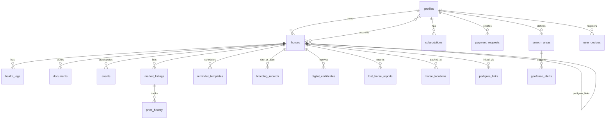

# Database — Schema Reference

> Source of truth for the database schema. Aligns with Dart models after Phase 1 local-first stabilization.
> For sync strategy and client architecture, see [architecture.md](./architecture.md).

---

## Entity Relationship Diagram



---

## Tables

### profiles

User account and subscription info. One per auth user.

```sql
CREATE TABLE profiles (
  id                UUID PRIMARY KEY REFERENCES auth.users(id) ON DELETE CASCADE,
  display_name      TEXT NOT NULL,
  phone             TEXT UNIQUE,
  region            TEXT,              -- аймаг/сум
  avatar_url        TEXT,
  subscription_tier TEXT NOT NULL DEFAULT 'free'
                    CHECK (subscription_tier IN ('free', 'pro', 'breeder', 'stable')),
  created_at        TIMESTAMPTZ NOT NULL DEFAULT now(),
  updated_at        TIMESTAMPTZ NOT NULL DEFAULT now()
);
```

### horses

Core entity. Unified `Horse` model (merged from HorseRecord + LineageHorse).

```sql
CREATE TABLE horses (
  id                    UUID PRIMARY KEY DEFAULT gen_random_uuid(),
  owner_id              UUID NOT NULL REFERENCES profiles(id) ON DELETE CASCADE,
  name                  TEXT NOT NULL,
  relation_label        TEXT DEFAULT '',
  gender                TEXT NOT NULL CHECK (gender IN ('stallion','mare','gelding','foal')),
  coat                  TEXT NOT NULL,
  birth_year            INTEGER NOT NULL CHECK (birth_year >= 1990 AND birth_year <= EXTRACT(YEAR FROM now())),
  award_count           INTEGER DEFAULT 0,
  offspring_count       INTEGER DEFAULT 0,
  microchip_id          TEXT,
  registration_no       TEXT,
  notes                 TEXT DEFAULT '',
  photo_urls            TEXT[] DEFAULT '{}',
  is_owned_by_household BOOLEAN DEFAULT true,
  lineage_root_id       UUID REFERENCES horses(id) ON DELETE SET NULL,
  created_at            TIMESTAMPTZ NOT NULL DEFAULT now(),
  updated_at            TIMESTAMPTZ NOT NULL DEFAULT now()
);

CREATE INDEX idx_horses_owner ON horses(owner_id);
CREATE INDEX idx_horses_name ON horses(name);
CREATE INDEX idx_horses_lineage_root ON horses(lineage_root_id);
```

**Dart model:** `lib/src/shared/domain/horse.dart` — `Horse`

### pedigree_links

Parent-child relationships between horses. Bidirectional (sire + dam).

```sql
CREATE TABLE pedigree_links (
  id          UUID PRIMARY KEY DEFAULT gen_random_uuid(),
  horse_id    UUID NOT NULL REFERENCES horses(id) ON DELETE CASCADE,
  parent_id   UUID NOT NULL REFERENCES horses(id) ON DELETE CASCADE,
  relation    TEXT NOT NULL CHECK (relation IN ('sire', 'dam')),
  verified    BOOLEAN DEFAULT false,
  created_at  TIMESTAMPTZ NOT NULL DEFAULT now(),
  UNIQUE(horse_id, parent_id)
);

CREATE INDEX idx_pedigree_horse ON pedigree_links(horse_id);
CREATE INDEX idx_pedigree_parent ON pedigree_links(parent_id);
```

### health_logs

Unified medical + farrier logs. Single table with `LogType` enum.

```sql
CREATE TABLE health_logs (
  id          UUID PRIMARY KEY DEFAULT gen_random_uuid(),
  horse_id    UUID NOT NULL REFERENCES horses(id) ON DELETE CASCADE,
  log_type    TEXT NOT NULL CHECK (log_type IN (
                'vaccination', 'deworming', 'treatment', 'vetVisit',
                'shoeing', 'trimming'
              )),
  date        DATE NOT NULL,
  notes       TEXT DEFAULT '',
  medicament  TEXT,
  cost        INTEGER CHECK (cost IS NULL OR cost >= 0),
  farrier_name TEXT,
  created_at  TIMESTAMPTZ NOT NULL DEFAULT now(),
  updated_at  TIMESTAMPTZ NOT NULL DEFAULT now()
);

CREATE INDEX idx_health_horse ON health_logs(horse_id);
CREATE INDEX idx_health_date ON health_logs(date);
CREATE INDEX idx_health_type ON health_logs(log_type);
```

**Dart model:** `lib/src/shared/domain/health_log.dart` — `HealthLog`, `LogType`

### events

Tournaments, races, competitions, training sessions.

```sql
CREATE TABLE events (
  id              UUID PRIMARY KEY DEFAULT gen_random_uuid(),
  horse_id        UUID NOT NULL REFERENCES horses(id) ON DELETE CASCADE,
  owner_id        UUID NOT NULL REFERENCES profiles(id) ON DELETE CASCADE,
  horse_name      TEXT DEFAULT '',
  event_type      TEXT NOT NULL DEFAULT 'race',
  title           TEXT NOT NULL,
  date_label      TEXT DEFAULT '',
  place_label     TEXT DEFAULT '',
  award_label     TEXT DEFAULT '',
  notes           TEXT DEFAULT '',
  is_upcoming     BOOLEAN DEFAULT false,
  photo_urls      TEXT[] DEFAULT '{}',
  created_at      TIMESTAMPTZ NOT NULL DEFAULT now(),
  updated_at      TIMESTAMPTZ NOT NULL DEFAULT now()
);

CREATE INDEX idx_events_horse ON events(horse_id);
CREATE INDEX idx_events_owner ON events(owner_id);
```

**Dart model:** `lib/src/features/events/domain/event_record.dart` — `EventRecord`

### market_listings

Buy, sell, lease, trade, stud horse listings. Includes boost/VIP/seller badge system.

```sql
CREATE TABLE market_listings (
  id                  UUID PRIMARY KEY DEFAULT gen_random_uuid(),
  horse_id            UUID NOT NULL REFERENCES horses(id) ON DELETE CASCADE,
  seller_id           UUID NOT NULL REFERENCES profiles(id) ON DELETE CASCADE,
  title               TEXT NOT NULL,
  description         TEXT DEFAULT '',
  price_amount        INTEGER NOT NULL CHECK (price_amount >= 0),
  currency            TEXT NOT NULL DEFAULT 'MNT' CHECK (currency IN ('MNT', 'USD')),
  sale_type           TEXT NOT NULL CHECK (sale_type IN ('sale', 'lease', 'trade', 'stud')),
  status              TEXT NOT NULL DEFAULT 'pending_verification'
                      CHECK (status IN ('active', 'pending_verification', 'sold', 'expired', 'rejected')),
  location_label      TEXT DEFAULT '',
  discipline_tags     TEXT[] DEFAULT '{}',
  document_tags       TEXT[] DEFAULT '{}',
  media_urls          TEXT[] DEFAULT '{}',
  is_seller_verified  BOOLEAN DEFAULT false,
  views_count         INTEGER DEFAULT 0,
  is_featured         BOOLEAN DEFAULT false,
  -- Boost/VIP/Badge system
  boost_level         TEXT NOT NULL DEFAULT 'none'
                      CHECK (boost_level IN ('none', 'standard', 'premium')),
  boost_expires_at    TIMESTAMPTZ,
  vip_level           TEXT NOT NULL DEFAULT 'none'
                      CHECK (vip_level IN ('none', 'standard', 'premium')),
  vip_expires_at      TIMESTAMPTZ,
  seller_badge        TEXT NOT NULL DEFAULT 'none'
                      CHECK (seller_badge IN ('none', 'shop')),
  seller_badge_expires_at TIMESTAMPTZ,
  created_at          TIMESTAMPTZ NOT NULL DEFAULT now(),
  updated_at          TIMESTAMPTZ NOT NULL DEFAULT now()
);

CREATE INDEX idx_market_status ON market_listings(status) WHERE status = 'active';
CREATE INDEX idx_market_seller ON market_listings(seller_id);
CREATE INDEX idx_market_price ON market_listings(price_amount);
CREATE INDEX idx_market_boosted ON market_listings(boost_level, vip_level)
  WHERE boost_level != 'none' OR vip_level != 'none';
```

**Dart model:** `lib/src/features/market/domain/market_listing.dart` — `MarketListing`

### payment_requests

Manual bank transfer payment verification for boosts and subscriptions.

```sql
CREATE TABLE payment_requests (
  id              UUID PRIMARY KEY DEFAULT gen_random_uuid(),
  user_id         UUID NOT NULL REFERENCES auth.users(id),
  tier            TEXT NOT NULL CHECK (tier IN ('pro', 'breeder', 'stable')),
  code            TEXT NOT NULL UNIQUE,
  amount_mnt      INTEGER NOT NULL,
  status          TEXT NOT NULL DEFAULT 'pending'
                  CHECK (status IN ('pending', 'verified', 'rejected', 'expired')),
  payment_type    TEXT NOT NULL DEFAULT 'subscription'
                  CHECK (payment_type IN ('subscription', 'listingBoost', 'sellerBadge')),
  created_at      TIMESTAMPTZ NOT NULL DEFAULT now(),
  verified_at     TIMESTAMPTZ,
  admin_notes     TEXT,
  expires_at      TIMESTAMPTZ NOT NULL
);
```

### price_history

Append-only price change log for market listings.

```sql
CREATE TABLE price_history (
  id              UUID PRIMARY KEY DEFAULT gen_random_uuid(),
  listing_id      UUID NOT NULL REFERENCES market_listings(id) ON DELETE CASCADE,
  price_amount    INTEGER NOT NULL,
  currency        TEXT NOT NULL DEFAULT 'MNT',
  recorded_at     TIMESTAMPTZ NOT NULL DEFAULT now()
);

CREATE INDEX idx_price_history_listing ON price_history(listing_id);
```

### co_ownerships

Shared ownership records. Name-based (not percentage-based).

```sql
CREATE TABLE co_ownerships (
  id              UUID PRIMARY KEY DEFAULT gen_random_uuid(),
  horse_id        UUID NOT NULL REFERENCES horses(id) ON DELETE CASCADE,
  co_owner_name   TEXT NOT NULL DEFAULT '',
  phone           TEXT DEFAULT '',
  role            TEXT DEFAULT 'owner',
  permissions     TEXT[] DEFAULT '{}',
  created_at      TIMESTAMPTZ NOT NULL DEFAULT now(),
  updated_at      TIMESTAMPTZ NOT NULL DEFAULT now(),
  UNIQUE(horse_id, co_owner_name)
);

CREATE INDEX idx_coownership_horse ON co_ownerships(horse_id);
```

**Dart model:** `lib/src/features/horses/domain/co_ownership.dart` — `CoOwnershipRecord`

### breeding_records

Breeding tracking between stallion and mare.

```sql
CREATE TABLE breeding_records (
  id                      UUID PRIMARY KEY DEFAULT gen_random_uuid(),
  sire_id                 UUID NOT NULL REFERENCES horses(id) ON DELETE CASCADE,
  sire_name               TEXT NOT NULL DEFAULT '',
  dam_id                  UUID NOT NULL REFERENCES horses(id) ON DELETE CASCADE,
  dam_name                TEXT NOT NULL DEFAULT '',
  breeding_date           DATE NOT NULL,
  expected_foaling_date   DATE NOT NULL,
  status                  TEXT NOT NULL DEFAULT 'active'
                          CHECK (status IN ('active', 'foaled', 'aborted')),
  herd_label              TEXT DEFAULT '',
  notes                   TEXT DEFAULT '',
  foal_id                 UUID REFERENCES horses(id) ON DELETE SET NULL,
  owner_id                UUID NOT NULL REFERENCES profiles(id) ON DELETE CASCADE,
  created_at              TIMESTAMPTZ NOT NULL DEFAULT now(),
  updated_at              TIMESTAMPTZ NOT NULL DEFAULT now()
);

CREATE INDEX idx_breeding_sire ON breeding_records(sire_id);
CREATE INDEX idx_breeding_dam ON breeding_records(dam_id);
CREATE INDEX idx_breeding_owner ON breeding_records(owner_id);
CREATE INDEX idx_breeding_status ON breeding_records(status) WHERE status = 'active';
```

**Dart model:** `lib/src/features/breeding/domain/breeding_record.dart` — `BreedingRecord`

### digital_certificates

Proof of ownership tied to a horse.

```sql
CREATE TABLE digital_certificates (
  id              UUID PRIMARY KEY DEFAULT gen_random_uuid(),
  horse_id        UUID NOT NULL REFERENCES horses(id) ON DELETE CASCADE,
  owner_user_id   UUID NOT NULL REFERENCES profiles(id) ON DELETE CASCADE,
  issued_at       TIMESTAMPTZ NOT NULL DEFAULT now(),
  is_active       BOOLEAN DEFAULT true,
  verification    TEXT NOT NULL,
  created_at      TIMESTAMPTZ NOT NULL DEFAULT now()
);

CREATE INDEX idx_certificates_horse ON digital_certificates(horse_id);
CREATE INDEX idx_certificates_active ON digital_certificates(horse_id) WHERE is_active = true;
```

### reminder_templates

Recurring reminder definitions per horse.

```sql
CREATE TABLE reminder_templates (
  id              UUID PRIMARY KEY DEFAULT gen_random_uuid(),
  horse_id        UUID NOT NULL REFERENCES horses(id) ON DELETE CASCADE,
  owner_id        UUID NOT NULL REFERENCES profiles(id) ON DELETE CASCADE,
  reminder_type   TEXT NOT NULL CHECK (reminder_type IN (
                    'vaccination', 'deworming', 'farrier', 'registration'
                  )),
  interval_days   INTEGER NOT NULL CHECK (interval_days > 0),
  last_done       DATE,
  next_due        DATE NOT NULL,
  is_active       BOOLEAN DEFAULT true,
  created_at      TIMESTAMPTZ NOT NULL DEFAULT now(),
  updated_at      TIMESTAMPTZ NOT NULL DEFAULT now()
);

CREATE INDEX idx_reminders_next_due ON reminder_templates(next_due) WHERE is_active = true;
```

### documents

Document vault — vet certs, insurance, registration, microchip docs.

```sql
CREATE TABLE documents (
  id            UUID PRIMARY KEY DEFAULT gen_random_uuid(),
  horse_id      UUID NOT NULL REFERENCES horses(id) ON DELETE CASCADE,
  owner_id      UUID NOT NULL REFERENCES profiles(id) ON DELETE CASCADE,
  doc_type      TEXT NOT NULL CHECK (doc_type IN (
                  'vet_cert', 'insurance', 'registration', 'microchip', 'other'
                )),
  title         TEXT NOT NULL,
  storage_path  TEXT NOT NULL,
  file_size     BIGINT CHECK (file_size IS NULL OR file_size >= 0),
  mime_type     TEXT,
  created_at    TIMESTAMPTZ NOT NULL DEFAULT now(),
  updated_at    TIMESTAMPTZ NOT NULL DEFAULT now()
);
```

### lost_horse_reports

Lost horse reporting with search radius and location.

```sql
CREATE TABLE lost_horse_reports (
  id              UUID PRIMARY KEY DEFAULT gen_random_uuid(),
  horse_id        UUID NOT NULL REFERENCES horses(id) ON DELETE CASCADE,
  owner_id        UUID NOT NULL REFERENCES profiles(id) ON DELETE CASCADE,
  horse_name      TEXT NOT NULL DEFAULT '',
  description     TEXT DEFAULT '',
  last_seen_lat   DOUBLE PRECISION NOT NULL,
  last_seen_lng   DOUBLE PRECISION NOT NULL,
  last_seen_at    TIMESTAMPTZ NOT NULL DEFAULT now(),
  search_radius_km DOUBLE PRECISION NOT NULL DEFAULT 10,
  status          TEXT NOT NULL DEFAULT 'active'
                  CHECK (status IN ('active', 'found', 'cancelled')),
  photo_url       TEXT,
  created_at      TIMESTAMPTZ NOT NULL DEFAULT now(),
  updated_at      TIMESTAMPTZ NOT NULL DEFAULT now()
);

CREATE INDEX idx_lost_horse_status ON lost_horse_reports(status) WHERE status = 'active';
```

### search_areas

Geofence circles for lost horse search and custom boundaries.

```sql
CREATE TABLE search_areas (
  id              UUID PRIMARY KEY DEFAULT gen_random_uuid(),
  owner_id        UUID NOT NULL REFERENCES profiles(id) ON DELETE CASCADE,
  name            TEXT NOT NULL DEFAULT '',
  center_lat      DOUBLE PRECISION NOT NULL,
  center_lng      DOUBLE PRECISION NOT NULL,
  radius_km       DOUBLE PRECISION NOT NULL DEFAULT 10,
  color           TEXT DEFAULT '#FF0000',
  is_active       BOOLEAN DEFAULT true,
  created_at      TIMESTAMPTZ NOT NULL DEFAULT now()
);
```

### horse_locations

Current horse positions (opt-in visibility).

```sql
CREATE TABLE horse_locations (
  id              UUID PRIMARY KEY DEFAULT gen_random_uuid(),
  horse_id        UUID NOT NULL REFERENCES horses(id) ON DELETE CASCADE,
  owner_id        UUID NOT NULL REFERENCES profiles(id) ON DELETE CASCADE,
  lat             DOUBLE PRECISION NOT NULL,
  lng             DOUBLE PRECISION NOT NULL,
  last_updated    TIMESTAMPTZ NOT NULL DEFAULT now(),
  is_visible      BOOLEAN DEFAULT false
);
```

### geofence_alerts

Alert history for geofence boundary crossings.

```sql
CREATE TABLE geofence_alerts (
  id              UUID PRIMARY KEY DEFAULT gen_random_uuid(),
  horse_id        UUID DEFAULT '',
  horse_name      TEXT DEFAULT '',
  geofence_id     UUID NOT NULL REFERENCES search_areas(id) ON DELETE CASCADE,
  geofence_name   TEXT DEFAULT '',
  alert_type      TEXT NOT NULL CHECK (alert_type IN ('entered', 'exited')),
  triggered_at    TIMESTAMPTZ NOT NULL DEFAULT now(),
  horse_lat       DOUBLE PRECISION NOT NULL,
  horse_lng       DOUBLE PRECISION NOT NULL,
  acknowledged    BOOLEAN DEFAULT false
);
```

### user_devices

FCM push notification token registration.

```sql
CREATE TABLE user_devices (
  id              UUID PRIMARY KEY DEFAULT gen_random_uuid(),
  user_id         UUID NOT NULL REFERENCES auth.users(id),
  fcm_token       TEXT NOT NULL,
  platform        TEXT NOT NULL CHECK (platform IN ('ios', 'android', 'web', 'macos')),
  created_at      TIMESTAMPTZ NOT NULL DEFAULT now(),
  last_seen_at    TIMESTAMPTZ NOT NULL DEFAULT now()
);
```

### subscriptions

Subscription records managed via RevenueCat / App Store.

```sql
CREATE TABLE subscriptions (
  id              UUID PRIMARY KEY DEFAULT gen_random_uuid(),
  profile_id      UUID NOT NULL REFERENCES profiles(id) UNIQUE,
  tier            TEXT NOT NULL CHECK (tier IN ('pro', 'breeder', 'stable')),
  store_platform  TEXT NOT NULL CHECK (store_platform IN ('appstore', 'playstore')),
  store_tx_id     TEXT NOT NULL UNIQUE,
  expires_at      TIMESTAMPTZ NOT NULL,
  is_active       BOOLEAN DEFAULT true,
  created_at      TIMESTAMPTZ NOT NULL DEFAULT now(),
  updated_at      TIMESTAMPTZ NOT NULL DEFAULT now()
);
```

---

## Row-Level Security (RLS) Policies

### Core Principle

Users see their own data. Co-owners see shared horses. Marketplace listings are publicly readable.

```sql
-- Profiles: own profile only
CREATE POLICY "Users can read own profile" ON profiles FOR SELECT USING (id = auth.uid());
CREATE POLICY "Users can update own profile" ON profiles FOR UPDATE USING (id = auth.uid());

-- Horses: owner or co-owner
CREATE POLICY "Horses select for owner or co-owner" ON horses FOR SELECT USING (
  owner_id = auth.uid()
  OR id IN (SELECT horse_id FROM co_ownerships WHERE co_owner_name = (
    SELECT display_name FROM profiles WHERE id = auth.uid()
  ))
);
CREATE POLICY "Horses insert by owner" ON horses FOR INSERT WITH CHECK (owner_id = auth.uid());
CREATE POLICY "Horses update by owner" ON horses FOR UPDATE USING (owner_id = auth.uid());
CREATE POLICY "Horses delete by owner" ON horses FOR DELETE USING (owner_id = auth.uid());

-- Pedigree: horse owner can manage
CREATE POLICY "Pedigree select for owner" ON pedigree_links FOR SELECT USING (
  horse_id IN (SELECT id FROM horses WHERE owner_id = auth.uid())
);

-- Health logs: horse owner can manage
CREATE POLICY "Health logs select for owner" ON health_logs FOR SELECT USING (
  horse_id IN (SELECT id FROM horses WHERE owner_id = auth.uid())
);
CREATE POLICY "Health logs insert by owner" ON health_logs FOR INSERT WITH CHECK (
  horse_id IN (SELECT id FROM horses WHERE owner_id = auth.uid())
);
CREATE POLICY "Health logs update by owner" ON health_logs FOR UPDATE USING (
  horse_id IN (SELECT id FROM horses WHERE owner_id = auth.uid())
);
CREATE POLICY "Health logs delete by owner" ON health_logs FOR DELETE USING (
  horse_id IN (SELECT id FROM horses WHERE owner_id = auth.uid())
);

-- Events: owner can manage
CREATE POLICY "Events select for owner" ON events FOR SELECT USING (owner_id = auth.uid());
CREATE POLICY "Events insert by owner" ON events FOR INSERT WITH CHECK (owner_id = auth.uid());
CREATE POLICY "Events update by owner" ON events FOR UPDATE USING (owner_id = auth.uid());
CREATE POLICY "Events delete by owner" ON events FOR DELETE USING (owner_id = auth.uid());

-- Marketplace: published listings public, seller manages own
CREATE POLICY "Market select published or own" ON market_listings FOR SELECT
  USING (status = 'published' OR seller_id = auth.uid());
CREATE POLICY "Market insert by seller" ON market_listings FOR INSERT
  WITH CHECK (seller_id = auth.uid());
CREATE POLICY "Market update by seller" ON market_listings FOR UPDATE
  USING (seller_id = auth.uid());

-- Price history: readable with listing
CREATE POLICY "Price history readable" ON price_history FOR SELECT USING (
  listing_id IN (SELECT id FROM market_listings WHERE status = 'published' OR seller_id = auth.uid())
);

-- Breeding: owner can manage
CREATE POLICY "Breeding select for owner" ON breeding_records FOR SELECT USING (owner_id = auth.uid());
CREATE POLICY "Breeding insert by owner" ON breeding_records FOR INSERT WITH CHECK (owner_id = auth.uid());
CREATE POLICY "Breeding update by owner" ON breeding_records FOR UPDATE USING (owner_id = auth.uid());
CREATE POLICY "Breeding delete by owner" ON breeding_records FOR DELETE USING (owner_id = auth.uid());

-- Certificates: publicly verifiable
CREATE POLICY "Certificates publicly verifiable" ON digital_certificates FOR SELECT USING (true);

-- Lost horse reports: owner manages, public reads active
CREATE POLICY "Lost horse public read active" ON lost_horse_reports FOR SELECT
  USING (status = 'active' OR owner_id = auth.uid());
CREATE POLICY "Lost horse insert by owner" ON lost_horse_reports FOR INSERT
  WITH CHECK (owner_id = auth.uid());
CREATE POLICY "Lost horse update by owner" ON lost_horse_reports FOR UPDATE
  USING (owner_id = auth.uid());

-- Search areas: owner manages own
CREATE POLICY "Search areas select for owner" ON search_areas FOR SELECT USING (owner_id = auth.uid());
CREATE POLICY "Search areas insert by owner" ON search_areas FOR INSERT WITH CHECK (owner_id = auth.uid());
CREATE POLICY "Search areas update by owner" ON search_areas FOR UPDATE USING (owner_id = auth.uid());

-- Horse locations: owner manages, visible horses readable by all
CREATE POLICY "Horse locations visible read" ON horse_locations FOR SELECT
  USING (is_visible = true OR owner_id = auth.uid());
CREATE POLICY "Horse locations insert by owner" ON horse_locations FOR INSERT
  WITH CHECK (owner_id = auth.uid());

-- Geofence alerts: owner manages own
CREATE POLICY "Geofence alerts select for owner" ON geofence_alerts FOR SELECT
  USING (geofence_id IN (SELECT id FROM search_areas WHERE owner_id = auth.uid()));
```

---

## Storage Buckets

```
Supabase Storage:
├── horse-photos/       [public read, owner write]
├── documents/          [owner read/write]
├── market-media/       [public read, seller write]
└── user-documents/     [owner read/write]  ← Document vault uploads
```

### Storage Limits by Tier

| Tier | Document Storage | Photo Cache (local) |
|------|------------------|---------------------|
| Free | 50 MB | 100 MB |
| Pro | 5 GB | 500 MB |
| Breeder | 20 GB | 500 MB |
| Stable | 50 GB | 1 GB |

---

## Subscription Enforcement

```sql
-- Free tier: max 1 horse
CREATE OR REPLACE FUNCTION check_free_tier_horse_limit()
RETURNS TRIGGER AS $$
DECLARE
  tier TEXT;
  count INTEGER;
BEGIN
  SELECT subscription_tier INTO tier FROM profiles WHERE id = NEW.owner_id;
  IF tier = 'free' THEN
    SELECT COUNT(*) INTO count FROM horses WHERE owner_id = NEW.owner_id;
    IF count >= 1 THEN
      RAISE EXCEPTION 'Free багцад зөвхөн 1 морь бүртгэх боломжтой.'
        USING ERRCODE = '22000';
    END IF;
  END IF;
  RETURN NEW;
END;
$$ LANGUAGE plpgsql;
```

---

## Migration Strategy

Schema changes managed via Supabase migrations in `supabase/migrations/`.

```
supabase/migrations/
├── 001_initial_schema.sql
├── 002_phase1_schema_update.sql   ← Phase 1: Horse merge, HealthLog merge, new tables
├── 009_boost_system.sql           ← Boost/VIP/seller badge columns + payment_type
├── 010_map_features.sql           ← Lost horse, search areas, horse locations, geofence alerts
└── ...
```

### Rules

1. Every schema change gets a numbered migration file
2. Migrations are forward-only — never edit a pushed migration
3. Test migrations locally before pushing to production
4. Client code must handle both old and new schema during rollout windows

---

## Key Design Decisions

| Decision | Rationale |
|----------|-----------|
| **UUID primary keys** | Offline-first: client can generate IDs without server round-trip |
| **`TEXT` for enums** | Postgres CHECK constraints; easier to extend than native ENUMs |
| **`TIMESTAMPTZ` everywhere** | Timestamps must be unambiguous across timezones |
| **Unified health_logs** | Single table for medical + farrier (Dart `HealthLog` model) |
| **Name-based co_ownership** | Simpler than percentage-based; matches Mongolian horse ownership culture |
| **Cascade deletes** | Horse deletion removes all related records |
| **No soft deletes** | Simple MVP; add later if needed for audit trails |

---

## Related

- [Product](./product.md) — feature inventory and tier definitions
- [Tech Stack](./tech-stack.md) — technology choices
- [Architecture](./architecture.md) — sync strategy, conflict resolution
