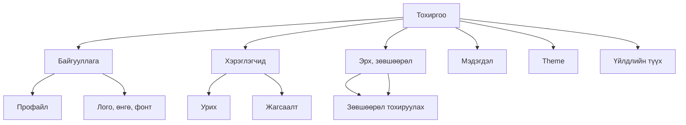

# Тохиргоо

Системийн бүх тохиргоог нэгдсэн цэснээс удирдах.

## Байгууллага

Байгууллагын мэдээллийг засварлах:

- Нэр, утас, хаяг
- Лого, өнгө, фонт
- Татварын мэдээлэл

## Хэрэглэгчид

Байгууллагын хэрэглэгчдийг удирдах:

- **Урих** — шинэ хэрэглэгч имэйлээр урих
- **Жагсаалт** — бүх хэрэглэгчийн жагсаалт
- **Эрх өөрчлөх** — хэрэглэгчийн эрхийг өөрчлөх
- **Устгах** — хэрэглэгчийг хасах

## Эрх, зөвшөөрөл (Roles & Permissions)

Эрхэд суурилсан хандалтын хяналт:

- **Эрх үүсгэх** — шинэ эрх үүсгэх (админ, кассчин, агуулахын эрхлэгч гэх мэт)
- **Зөвшөөрөл тохируулах** — модуль тус бүрээр зөвшөөрөл тохируулах
- **PermissionGate** — UI элементүүдийг эрхээр харуулах/нуулах

## Мэдэгдэл

Мэдэгдлийн тохиргоо:

- **Telegram бот** — Telegram ботоор мэдэгдэл хүлээн авах
- **Имэйл (SMTP)** — имэйлээр тайлан, мэдэгдэл хүлээн авах

## Theme

Байгууллагын өнгө, фонт, харагдах байдлын тохиргоо:

- Лого зураг
- Үндсэн өнгө
- Фонт
- CSS хувьсагчаар тохиргоо

## Үйлдлийн түүх (Audit Log)

Бүх хэрэглэгчийн үйлдлийн түүх:

- Хэрэглэгч
- Цаг хугацаа
- Үйлдлийн төрөл
- Дэлгэрэнгүй мэдээлэл
