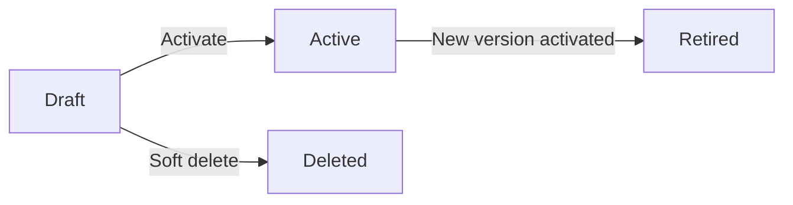

# Үйлдвэрлэлийн модуль — Хэрэгжүүлэх төлөвлөгөө

## Товч дүгнэлт

Анхны төлөвлөгөөний чиглэл зөв боловч хэрэгжүүлж эхлэхээс өмнө дараах суурь асуудлуудыг шийдэх шаардлагатай:

1. `manufacturing` organization type болон preset category аль хэдийн байна. Харин default feature сонголт onboarding-д холбогдоогүй байна (`src/lib/constants.ts:14-23`, `src/lib/constants.ts:92-104`, `src/app/(onboarding)/onboarding/wizard-client.tsx:73-75`).
2. **0-р шатанд DB өөрчлөлт шаардлагатай.** Шинэ модульд permission enum, role backfill, RLS permission checks хэрэгтэй. Одоогийн permission систем DB enum дээр суурилдаг (`supabase/migrations/20260616000006_create_roles_and_permissions.sql:77-123`).
3. Sidebar-аас нуух нь хамгаалалт биш. Direct URL, Server Action, RPC түвшинд feature болон permission хоёуланг шалгах хэрэгтэй. Одоогийн navigation filter зөвхөн sidebar item шүүдэг (`src/lib/navigation.ts:213-248`).
4. BOM version, үйлдвэрлэлийн материал, хөдөлмөрийн үнэ зэргийг snapshot хийхгүй бол хуучин захиалгын зардал ирээдүйд өөрчлөгдөнө.
5. Захиалга үүсгэх, материал гаргах/буцаах, дугаар олгох зэрэг нь олон тусдаа query биш, transactional RPC байх ёстой.
6. `stock_movements.type`-д `production` нэмэх шаардлагагүй. Хөдөлгөөний чиглэлийг `out`/`in`-ээр, эх үүсвэрийг `production_material_id`-аар ялгана.
7. Нэг `sale_id` олон `sale_items` агуулдаг тул үйлдвэрлэлийн захиалга `sale_item_id`-тай холбогдох шаардлагатай (`src/lib/database.types.ts:4225-4272`).
8. Ханшуны CSV формат бодит файлаар баталгаажаагүй. Тиймээс импортын mapping дүрмийг sample файл дээр үндэслэн түгжинэ.
9. Нэг migration болон “ойролцоогоор 15 файл” гэсэн анхны жагсаалт бодит scope-ийг дутуу тооцсон.

---

## 1. Хамрах хүрээ

### V1-д багтах

- Manufacturing feature болон permission gating
- Бүтээгдэхүүний төрөл
- Version-тэй BOM
- Үйлдвэрлэлийн захиалга
- Захиалгын шатны хяналт
- Материалын шаардлага, гаргалт, буцаалт
- Материал болон хөдөлмөрийн бодит зардал
- Борлуулалтын мөртэй холбосон ашиг/алдагдал
- Ханшун CSV импортын mapping wizard
- Append-only чанарын шалгалт

### V1-ээс хасах

- Хавтангийн nesting/cutting optimization
- Offcut буюу тайрдас дахин ашиглалтын бүртгэл
- Машин, төхөөрөмжийн хүчин чадлын төлөвлөлт
- WIP болон COGS-ийн автомат journal posting
- FIFO/weighted-average costing engine-ийн шинэчлэл
- Barcode/IoT integration
- Product-specific workflow template editor

Эдгээрийг BOM болон үйлдвэрлэлийн үндсэн урсгал тогтворжсоны дараагийн хувилбарт тусад нь төлөвлөнө.

---

## 2. Хэрэгжүүлэхээс өмнө түгжих шийдвэрүүд

Дараах дөрвөн шийдвэргүйгээр schema-г батлахгүй:

| Шийдвэр | Яагаад хэрэгтэй |
|---|---|
| Ханшуны 2–3 бодит CSV sample | Encoding, delimiter, header, BOM төрөл, хэмжээний форматыг тогтооно |
| Хөдөлмөрийн цагийн үнэ | `monthly` цалинг hourly rate болгох дүрэм одоогоор байхгүй; employee schema зөвхөн `base_salary`, `salary_type` хадгалдаг (`src/lib/database.types.ts:1432-1479`) |
| Агуулахын stock source of truth | `warehouse_products` хүснэгт байгаа боловч одоогийн sale/restock RPC-үүд голчлон `products.current_stock` шинэчилдэг |
| Default production stage | Хайчлах → ирмэг наах → угсрах → будах → савлах дараалал бүх manufacturing org-д тохирох эсэх |

---

## 3. Хэрэгжүүлэх үе шат

### 0-р шат — Feature, permission, onboarding

#### Зорилго

Manufacturing organization шинээр үүсэхэд үйлдвэрлэлийн модулиудыг зөв санал болгож, existing organization Тохиргооноос идэвхжүүлдэг болгох.

#### Feature keys

```text
production_orders
bom
job_costing
quality_control
material_tracking
```

`MANUFACTURING_DEFAULTS`-ийг дангаар нэмэхгүй. Company type-оос default feature гаргадаг нэг resolver үүсгээд дараах хоёр газарт ашиглана:

1. Onboarding UI-ийн initial selection
2. Server-side onboarding validation/persistence

Onboarding одоогоор `selectedFeatures`-ийг хоосон `Set`-ээр эхлүүлдэг бөгөөд сонгосон утгыг л `organizations.enabled_features` рүү бичдэг (`src/app/(onboarding)/onboarding/wizard-client.tsx:73-75`, `src/app/(onboarding)/onboarding/actions.ts:50-66`).

#### Permissions

DB enum-д:

```text
boms.create
boms.read
boms.update
boms.delete

production_orders.create
production_orders.read
production_orders.update
production_orders.delete

production_costs.read

quality_checks.create
quality_checks.read
```

Мөн:

- Owner role-д бүх шинэ permission
- Existing admin role-д `roles.manage`-аас бусад шинэ permission
- Staff role-д автоматаар олгохгүй
- `PERMISSION_GROUPS` болон `PERMISSION_LABELS` шинэчлэгдэнэ (`src/lib/permissions.ts:11-20`, `src/lib/permissions.ts:124-153`)

#### Feature enforcement

Гурван давхар хамгаалалт:

1. Sidebar visibility
2. Page loader дээр feature + read permission
3. Mutation/RPC дээр feature + write permission

Write actions нь existing `requireWriteAction()` branch болон permission guard-ийг дагана (`src/lib/action-utils.ts:47-91`).

#### Acceptance gate

- Manufacturing org шинээр үүсэхэд зөв модулиуд урьдчилан сонгогдсон байна.
- Existing org Тохиргооноос manufacturing feature идэвхжүүлнэ.
- Feature унтраалттай үед sidebar item харагдахгүй.
- Direct URL болон Server Action дуудлага зөвшөөрөлгүй үед denied болно.
- Owner/admin role шинэ permission-үүдээ авсан байна.

---

### 1-р шат — Product classification болон version-тэй BOM

#### `products` өөрчлөлт

`material_type`:

```text
raw_material
hardware
finished_good
```

Дүрэм:

- `CHECK` constraint-тай
- Existing бүтээгдэхүүнд nullable эсвэл тодорхой migration default хэрэглэнэ
- Өргөн, урт, зузаан зэрэг product master data-г шинэ багануудаар давхардуулахгүй; existing product attribute system ашиглана. Энэ систем numeric value болон unit аль хэдийн дэмждэг (`supabase/migrations/20260711000002_create_product_attribute_system.sql:9-23`, `:35-66`).

#### `product_boms`

Үндсэн талбарууд:

```text
id
organization_id
product_id
name
version
status: draft | active | retired
notes
activated_at
created_at
updated_at
deleted_at
```

Constraints:

- `UNIQUE (organization_id, product_id, version)`
- Нэг бүтээгдэхүүнд зөвхөн нэг active BOM байх partial unique constraint
- `version > 0`
- Active/retired BOM-ыг шууд засварлахгүй
- Production order ашигласан BOM-ыг hard-delete хийхгүй

#### `bom_items`

```text
id
organization_id
bom_id
material_product_id
quantity
unit
required_width_mm
required_length_mm
required_thickness_mm
estimated_unit_cost
sort_order
notes
created_at
updated_at
deleted_at
```

Дүрэм:

- `quantity > 0`
- Хэмжээ өгөгдсөн бол `> 0`
- `unit` нь material product-ийн stock unit эсвэл existing UOM conversion-той нийцнэ
- Product master хэмжээ нь attribute system-д; BOM item хэмжээ нь зөвхөн тухайн огтлол/хэрэглээний шаардлага

#### BOM lifecycle



Activation нь transaction байна:

1. Draft BOM болон бүх item-ийг validate хийнэ.
2. Одоогийн active BOM-ыг retired болгоно.
3. Draft BOM-ыг active болгоно.
4. Нэг бүтээгдэхүүнд нэг active version үлдсэнийг constraint батална.

#### UI

Zer-ийн drawer convention дагана:

- `/bom` — PPR list page
- Create BOM drawer
- Edit draft BOM drawer
- Detail drawer
- Activate confirmation
- Version history
- Products хэсэгт `BOM харах/үүсгэх`

Шинэ `/bom/new`, `/bom/[id]` full page шаардлагагүй. Existing list modules create/detail/edit drawer ашигладаг (`src/app/(dashboard)/discounts/discounts-content.tsx:7-19`, `:51-65`).

#### Acceptance gate

- Draft BOM засагдана.
- Active BOM immutable байна.
- Шинэ version идэвхжүүлэхэд өмнөх active version retired болно.
- Cross-org product эсвэл material холбож болохгүй.
- BOM нийт estimated cost зөв гарна.
- Soft-deleted BOM list болон product lookup-д харагдахгүй.

---

### 2-р шат — Үйлдвэрлэлийн захиалга

#### `production_orders`

```text
id
organization_id
branch_id
order_number
sale_item_id
product_id
bom_id
bom_version
quantity
status
priority
planned_start_date
planned_end_date
actual_start_at
actual_end_at
estimated_cost_snapshot
completed_actual_cost
notes
created_by
created_at
updated_at
deleted_at
```

Чухал дүрэм:

- `branch_id` заавал байна.
- Revenue source нь `sale_id` биш `sale_item_id`.
- `order_number` нь `(organization_id, order_number)` unique.
- Дугаарыг client/server action дээр `MAX + 1` гэж үүсгэхгүй; row lock эсвэл sequence ашигласан RPC үүсгэнэ.
- Status болон priority нь `CHECK` constraint-тай байна.
- Planned end date нь start date-аас өмнө байж болохгүй.

#### `production_stages`

```text
production_order_id
stage_name
stage_order
status: pending | in_progress | completed | skipped
started_at
completed_at
notes
```

Constraints:

- `UNIQUE (production_order_id, stage_order)`
- Completed stage-д `completed_at` шаардлагатай
- Нэг order-ийн stage өөр organization-д харьяалагдах боломжгүй

V1-д default stage sequence ашиглана. Product-specific workflow editor дараагийн scope.

#### `production_materials`

Энэ хүснэгт нь BOM item-ийн snapshot байна:

```text
production_order_id
source_bom_item_id
product_id
required_quantity
issued_quantity
used_quantity
returned_quantity
unit
required dimensions
estimated_unit_cost_snapshot
warehouse_id
created_at
updated_at
```

`pending/issued/returned` гэсэн нэг status ашиглахгүй. Partial issue болон partial return-ыг тоон талбаруудаар илэрхийлнэ.

#### Transactional order creation RPC

`create_production_order(...)` RPC:

1. Feature, permission, org, branch шалгана.
2. Product болон active BOM-ыг lock/validate хийнэ.
3. Race-safe order number үүсгэнэ.
4. Order үүсгэнэ.
5. Default stages үүсгэнэ.
6. BOM item-үүдийг order quantity-аар үржүүлж material snapshot үүсгэнэ.
7. Estimated cost snapshot хадгална.
8. Аль нэг алхам алдахад бүх өөрчлөлт rollback хийнэ.

#### UI

- `/production` — table/list
- Create production order drawer
- Wide detail drawer
- Stage timeline/stepper
- Material requirements section
- Cost summary section
- Status transition actions

Kanban ашиглахгүй. Нэг захиалгын доторх шатнууд зэрэгцээ task биш, дараалсан lifecycle тул timeline/stepper илүү тохиромжтой.

#### Acceptance gate

- Хоёр concurrent request ижил order number авахгүй.
- Захиалга active BOM-ын immutable snapshot ашиглана.
- BOM дараа нь өөрчлөгдсөн ч өмнөх order-ийн material/cost өөрчлөгдөхгүй.
- Branch-scoped хэрэглэгч өөр салбарын order харахгүй.
- Sale item холбоотой үед revenue тухайн мөрийн `total_price`-аас гарна.

---

### 3-р шат — Материал гаргалт болон буцаалт

#### `stock_movements` өөрчлөлт

`stock_movements.type`-д `production` нэмэхгүй:

| Үйлдэл | `type` |
|---|---|
| Үйлдвэрлэлд материал гаргах | `out` |
| Ашиглаагүй материалыг буцаах | `in` |

Нэмэх холбоосууд:

```text
production_material_id
operation_id
```

`operation_id` нь retry болон double-submit үед idempotency хангана.

#### Transactional RPC-үүд

```text
issue_production_materials(...)
return_production_materials(...)
record_production_usage(...)
```

RPC бүр:

- Feature болон permission шалгана
- Order/material row-уудыг lock хийнэ
- Organization болон branch ownership шалгана
- Negative stock-ийг атомикаар хориглоно
- Stock movement үүсгэнэ
- Issued/returned quantity-г шинэчилнэ
- Ижил `operation_id` дахин ирвэл давхар хөдөлгөөн үүсгэхгүй
- Алдаа гарвал бүх өөрчлөлтийг rollback хийнэ

#### Warehouse stock decision

Одоогийн schema-д `warehouse_products.current_stock` байна (`supabase/migrations/20260616000001_create_warehouses.sql:11-23`). Гэхдээ existing sale/restock flow-ууд `products.current_stock` болон variant stock-ийг шууд шинэчилдэг.

Тиймээс хоёр сонголтоос нэгийг scope-д тодорхой түгжинэ:

- **V1 санал:** existing aggregate stock-ийг source of truth хэвээр ашиглаж, `warehouse_id`-г хөдөлгөөний attribution хэлбэрээр хадгалах.
- Жинхэнэ warehouse-level availability шаардлагатай бол sales, restock, adjustment, production бүх урсгалыг нэг ledger дээр нэгтгэх ажлыг тусдаа prerequisite болгох.

Production модуль дангаараа `warehouse_products` шинэчилж эхэлбэл existing inventory-тэй зөрүү үүснэ.

#### Acceptance gate

- Хүрэлцэхгүй үлдэгдэлтэй issue бүхэлдээ цуцлагдана.
- Double-click/retry давхар stock movement үүсгэхгүй.
- Partial issue болон partial return зөв дүнтэй байна.
- `issued - returned` нь материалын бодит net issue-тэй таарна.
- Өөр branch/organization warehouse ашиглаж болохгүй.

---

### 4-р шат — Job costing

#### `production_stage_labor`

Нэг шатанд олон ажилтан оролцож болох тул `assigned_to + labor_hours`-ийг `production_stages` дээр шууд хадгалахгүй:

```text
id
organization_id
production_stage_id
employee_id
hours
hourly_rate_snapshot
labor_cost
created_at
updated_at
```

Constraints:

- `hours > 0`
- `hourly_rate_snapshot >= 0`
- `labor_cost = hours × hourly_rate_snapshot` дүрмийг server/RPC батална

`hourly_rate_snapshot`-ийг заавал хадгална. Одоогийн employee цалин өөрчлөгдсөн ч хуучин order-ийн зардал өөрчлөгдөх ёсгүй.

#### Cost formula

```text
Материалын бодит зардал
  = OUT stock movement cost
  - RETURN stock movement cost

Хөдөлмөрийн бодит зардал
  = Σ(hours × hourly_rate_snapshot)

Нийт бодит зардал
  = material actual cost
  + labor actual cost

Орлого
  = linked sale_item.total_price

Ашиг
  = revenue - actual cost
```

Current product cost-оос дахин тооцохгүй. Issue хийх үеийн `stock_movements.unit_cost` snapshot ашиглана.

#### V1-д орохгүй

- Overhead allocation
- WIP journal entry
- COGS posting
- FIFO/weighted average engine

#### UI

- Production detail drawer-д cost breakdown
- `/job-costing` — permission-protected report
- Product, month, status, branch filters
- Revenue холбоогүй internal production order-ийг “Орлого холбоогүй” гэж харуулна; ашгийг `0 - cost` гэж төөрөгдүүлж харуулахгүй

#### Acceptance gate

- Product/employee үнэ дараа нь өөрчлөгдсөн ч completed order cost тогтвортой байна.
- Return хийсэн материал нийт зардлыг бууруулна.
- Sale item байхгүй order-д profitability биш зөвхөн cost харуулна.
- Financial cost report зөв permission-гүй хэрэглэгчид харагдахгүй.

---

### 5-р шат — Ханшун BOM импорт

#### Prerequisite

Хэрэгжүүлэхээс өмнө:

- Ядаж 2–3 бодит CSV sample
- Encoding: UTF-8, GBK эсвэл UTF-16 эсэх
- Delimiter: comma, semicolon, tab
- Decimal болон хэмжээсийн формат
- Нэг файлд хэдэн төрлийн list байдгийг тогтооно

#### UI

Нэг `/bom/import` wizard:

```text
Upload → Column mapping → Validate → Material resolution → Confirm
```

Гурван тусдаа route шаардлагагүй.

#### Import flow

1. Файлын хэмжээ, MIME/extension шалгах
2. Encoding болон delimiter илрүүлэх
3. Standards-compliant CSV parse хийх
4. Column mapping санал болгох
5. Quantity/unit/dimensions validate хийх
6. Material name/SKU-г existing products-тэй map хийх
7. Unresolved material-уудыг хэрэглэгчээр шийдүүлэх
8. Server дээр дахин parse/validate хийх
9. Шинэ draft BOM version-ийг transaction-аар үүсгэх
10. Import hash эсвэл operation ID-аар давхар импорт хориглох

Одоогийн product bulk parser CSV мөрийг энгийн `split(",")` хийдэг тул quoted comma, multiline field, encoding дэмжихгүй (`src/app/(dashboard)/products/bulk/page.tsx:144-175`). Үүнийг BOM импортод дахин ашиглахгүй.

Шинэ CSV dependency шаардлагатай бол dependency нэмэхээс өмнө тусдаа зөвшөөрөл авна.

#### Acceptance gate

- Quoted comma болон хоосон багана зөв parse хийнэ.
- Malformed row бүр row-level error-той харагдана.
- Unresolved material үлдсэн үед confirm хаалттай байна.
- Preview болон server result ижил байна.
- Retry давхар BOM version үүсгэхгүй.

---

### 6-р шат — Чанарын хяналт

#### `quality_checks`

```text
id
organization_id
production_order_id
production_stage_id
check_type: in_process | final
result: pass | fail | conditional
defect_description
checked_by
checked_at
created_at
```

Quality check нь audit record тул:

- Append-only
- SELECT болон INSERT policy
- Ердийн хэрэглэгч UPDATE/DELETE хийхгүй
- Correction шаардлагатай бол шинэ superseding check үүсгэнэ

#### Photos

`defect_photos TEXT[]` дангаар ашиглахгүй:

- Private Supabase Storage bucket
- Organization/order prefix
- INSERT/SELECT/DELETE policies
- DB дээр object path хадгалах
- Signed URL-аар харах

#### Completion rule

Production order completion RPC:

1. Бүх required stage completed эсэхийг шалгана.
2. Final quality check байгаа эсэхийг шалгана.
3. Хамгийн сүүлийн final result `pass` эсвэл зөвшөөрөгдсөн `conditional` эсэхийг шалгана.
4. `fail` байвал completion-ийг хориглоно.

#### Acceptance gate

- Failed final check-тэй order completed болохгүй.
- Quality record засварлагдах/устгагдахгүй.
- Өөр organization defect photo харахгүй.
- QC feature унтраалттай org-д final-check requirement хэрэглэхгүй байх дүрэм тодорхой байна.

---

## 4. Migration стратеги

Нэг `20260717_manufacturing.sql` файлд бүгдийг хийхгүй. Үе шат тус бүрээр migration хуваана:

```text
01_manufacturing_features_permissions.sql
02_manufacturing_bom.sql
03_manufacturing_orders.sql
04_manufacturing_inventory.sql
05_manufacturing_costing.sql
06_manufacturing_quality.sql
```

Migration бүр:

- `public.` schema-г explicit ашиглах
- `NOT NULL`, `CHECK`, `UNIQUE`, индексүүдтэй байх
- FK delete behavior-ийг explicit тодорхойлох
- RLS `TO authenticated`
- UPDATE policy-д `USING` болон `WITH CHECK`
- Organization/branch/permission check
- Cross-org parent холбоосыг RPC, trigger эсвэл composite FK-ээр хориглох
- Required grants
- Existing owner/admin role backfill
- Security-definer RPC-д fixed `search_path`
- RPC execute grant-ийг зөвхөн шаардлагатай role-д өгөх

Migration бүрийн дараа:

1. Supabase development branch эсвэл local environment дээр apply хийх
2. RPC/RLS integration tests ажиллуулах
3. Remote project-д migration apply хийх
4. `src/lib/database.types.ts` regenerate хийх
5. `src/lib/supabase/types.ts`-д ижил generated output хадгалах
6. Supabase advisors ажиллуулах

---

## 5. Verification matrix

| Түвшин | Шалгалт |
|---|---|
| Schema | Constraints, indexes, FK behavior |
| Security | Cross-org, cross-branch, missing permission, disabled feature |
| Concurrency | Order number collision, double issue, insufficient stock |
| Historical integrity | BOM/product/employee cost өөрчлөхөд old order drift хийхгүй |
| Import | Encoding, quoted CSV, malformed rows, duplicate submission |
| UI | Loading, empty, error, populated state; create/edit/detail drawer |
| PPR | Page chrome үргэлж харагдаж, data inline skeleton-load хийх |
| Runtime | Browser-аар BOM → production → issue → complete flow |
| Type safety | Generated Supabase types + app typecheck |
| Build | Monorepo root-оос `pnpm build:zer` |

Focused verification commands:

```bash
pnpm lint
pnpm typecheck
pnpm test
```

Дараа нь monorepo root-оос:

```bash
pnpm build:zer
```

Browser smoke flow:

```text
Manufacturing org үүсгэх
→ BOM draft үүсгэх
→ BOM activate хийх
→ Production order үүсгэх
→ Partial material issue хийх
→ Stage labor бүртгэх
→ Material return хийх
→ Final QC pass хийх
→ Order complete хийх
→ Job profitability шалгах
```

---

## 6. Scope-ийн дүгнэлт

Анхны **20–26 өдрийн хугацааг одоогоор баталгаатай гэж үзэх боломжгүй**. Дараах зүйлс түгжигдээгүй байна:

- Ханшуны бодит CSV формат
- Labor hourly-rate дүрэм
- Warehouse-level stock source of truth
- Production stage customization
- Permission matrix

Иймээс calendar deadline-аас өмнө phase бүрийг дээрх acceptance gate-аар удирдана.

Нийт өөрчлөлтийн бодит хүрээ:

```text
Шинэ DB хүснэгт: 7
Өөрчлөх хүснэгт: 2+
RPC: дор хаяж 5
Storage bucket/policies: 1 багц
Migration: 6
UI: 3 үндсэн module + drawers
Tests: RLS, RPC concurrency, actions, browser flow
```

“6 хүснэгт, ~15 файл” гэсэн анхны жагсаалт бодит ажлын хэмжээг дутуу харуулсан.

---

## 7. Тусдаа илэрсэн security асуудал

Supabase MCP `get_advisors` шалгалтаар manufacturing scope-оос үл хамаарах, өмнө нь байсан зургаан `agent_*` хүснэгт дээр RLS disabled гэсэн critical advisory илэрсэн.

Үүнийг manufacturing migration-д хольж засахгүй. Тусдаа security issue болон migration болгон шийдвэрлэнэ.
